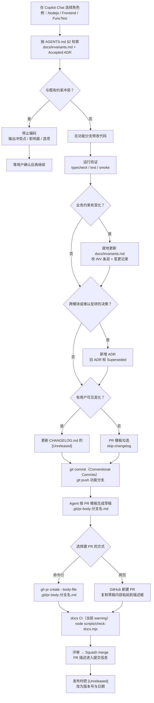

# summer-camp

```text
summer-camp
├── server/   # Express + TypeScript 服务端（认证 /user + 申请表 /form，接口见 server/README.md）
└── ui/       # Vue 3 + Vite 前端 SPA（登录 / 学生申请表 / Application Status / 管理端 / 导师端）
```

接口说明见 [server/README.md](./server/README.md)。

## 目录

- [文档与协作流程](#文档与协作流程)
  - [各文档的职责](#各文档的职责)
  - [从调用 Agent 到合并 PR](#从调用-agent-到合并-pr)
- [重要提醒：申请表必须选择预设的两个 supervisor](#注意---在填写申请表的时候必须要选择预设的两个supervisor否则application-form的流程不能完成)
- [用角色 Agent 构建系统（工作流）](#用角色-agent-构建系统工作流)
- [演示模式](#演示模式)
  - [模式一：后端跑 Docker 镜像 + 前端跑 Vite dev server（推荐）](#模式一推荐后端跑-docker-镜像--前端跑-vite-dev-server推荐)
  - [模式二：前后端都用本地 npm 启动（需要自备 MySQL）](#模式二前后端都用本地-npm-启动需要自备-mysql)
- [POSTMAN Collections](#postman-collections)
  - [通用前置](#通用前置)
  - [一、Auth：注册与登录流程](#一auth注册与登录流程)
  - [二、Form：申请表业务流程](#二form申请表业务流程)

## 注意 - 在填写申请表的时候必须要选择预设的两个supervisor,否则application form的流程不能完成

## 用角色 Agent 构建系统（工作流）

[`docs/`](./docs) 下的文档说明项目约束与决策；角色契约在 [`.github/agents/`](./.github/agents)，所有角色的共同规则见 [AGENTS.md](./AGENTS.md)。把对应文档作为该角色的规则，按下面顺序把上一阶段产物作为下一阶段输入：

| 阶段 | 角色 | 输入 → 产出 |
| --- | --- | --- |
| 1 拆解需求 | [architecture-agent](./.github/agents/architecture.agent.md) | 需求原文 → 范围、角色矩阵、状态机、验收标准、非目标 |
| 2 分析系统组成 | [architecture-agent](./.github/agents/architecture.agent.md) | 领域模型 → 模块边界、接口契约、数据策略、构建顺序、部署/回滚 |
| 3 UI/UX 设计 | [uiux-agent](./.github/agents/uiux.agent.md) | 流程与状态 → 页面清单、线框/视觉、状态矩阵、英文文案 |
| 4 Node.js coding | [nodejs-agent](./.github/agents/nodejs.agent.md) | 契约 + 数据模型 → API、校验、事务、权限、错误码、审计 |
| 5 UI coding | [frontend-agent](./.github/agents/frontend.agent.md) | 契约 + 设计规格 → 路由、页面、表单、联调 |
| 6 测试 / Postman | [func-test-agent](./.github/agents/func-test.agent.md) | 契约 + 用例矩阵 → 生成/更新 Postman collection、执行结果、缺陷 |

- 阶段 2、3 可并行；4、5 在契约冻结后并行；6 从阶段 1 就开始写用例，不等代码完成。
- 契约变更回阶段 1 更新，再同步 4/5/6，避免各角色各打补丁。
- 每阶段出口：勾选该角色文档的 DoD，并至少有一条真实请求、页面或断言验证通过。
- 数据库设计由 [sql-design-agent](./.github/agents/sql-design.agent.md) 在阶段 2 后介入，产出模型、约束、索引与迁移。

## 文档与协作流程

### 各文档的职责

| 文档 | 作用 | 什么时候写 | 权威层级 |
| --- | --- | --- | --- |
| [AGENTS.md](./AGENTS.md) | 所有 AI agent 的唯一工作规则：检索顺序、改动约束、收工流程、权威顺序 | 规则本身变化时（少见） | 流程规则 |
| [.github/agents/*.agent.md](./.github/agents) | 六个角色契约：职责、技能、产出、DoD | 角色职责或 DoD 变化时 | 流程规则，低于 `AGENTS.md` |
| [docs/README.md](./docs/README.md) | 文档导航、四类文档分工、选择决策树 | 新增或调整文档类型时 | 索引 |
| [docs/invariants.md](./docs/invariants.md) | 现行业务约束的唯一登记表（INV-01 ~ INV-22）：一句话规则 + 代码锚点 + 测试锚点 | 业务规则增删改时**就地更新** | 低于代码/测试与 `Accepted` ADR |
| [docs/decisions/](./docs/decisions/) | ADR：背景、选项、决策、理由、后果、回滚；不可直接改写 | 跨模块契约或难以反转的决策变化 | 低于代码/测试，高于 `invariants.md` |
| [docs/test-matrix.md](./docs/test-matrix.md) | 需求追踪、状态真值表、展示矩阵、用例矩阵、发布门禁 | 需求或用例变化时 | 测试依据 |
| [server/README.md](./server/README.md) | 接口、错误码、运行方式说明 | 接口契约变化时同步 | 说明性文档 |
| [.github/pull_request_template.md](./.github/pull_request_template.md) | PR 描述结构：变更类型、INV 前后对比、验证、回滚 | 模板本身变化时（少见） | 模板 |
| `.git/pr-body-分支名.md` | agent 生成的 PR 描述草稿，**只在本机、不入库** | 每次开 PR 前 | 草稿 |
| [CHANGELOG.md](./CHANGELOG.md) | 面向使用者的版本变更记录（Keep a Changelog） | 有用户可见变化时更新 `[Unreleased]` | 发布记录 |
| [.agent-history/](./.agent-history/ARCHIVE.md) | 2026-11-24 之前的会话历史，只读归档 | 只读，不再新增 | 最低，仅作背景 |

### 从调用 Agent 到合并 PR



关键约定：

- 草稿只放 `.git/pr-body-<分支名>.md`（文件名以 `pr-` 开头即可，Windows 用 `.git\`）。`.git/` 不受版本控制，不会把草稿提交进仓库。
- 生成草稿前，让 agent 读取 `git diff --stat origin/main...HEAD`、验证日志和本次 INV 变更；「验证」一节只写真实执行过的命令与结果。
- 网页建 PR 时：先创建 PR，再用 `Get-Content` 读取草稿并粘贴；已有 PR 可直接用 `gh pr edit` 覆盖描述。

```powershell
git fetch origin main
git diff --stat origin/main...HEAD
git --no-pager diff origin/main...HEAD > .git\change.diff
# 让 agent 读 change.diff、验证日志与 INV 变更，写出 .git\pr-body-当前分支名.md

# 网页建 PR 时复制到剪贴板
Get-Content .git\pr-body-当前分支名.md -Raw | Set-Clipboard

# 或用命令行建 PR / 更新已有 PR 的描述
gh pr create --base main --title "feat(server): ..." --body-file .git\pr-body-当前分支名.md
gh pr edit 123 --body-file .git\pr-body-当前分支名.md
```

## 演示模式

### 模式一（推荐）：后端跑 Docker 镜像 + 前端跑 Vite dev server（推荐）

数据库、迁移、后端 API 全部由 `docker-compose.yml` 拉起；前端仍用 Vite dev server，保留热更新。
Vite 已把 `/user`、`/form`、`/healthz` 代理到 `http://localhost:3000`，浏览器视角与后端同源，Cookie / CSRF 无需额外配置。

```bash
# 1. 准备后端配置（首次执行）
cd server
cp .env.example .env
# 至少填 JWT_SECRET（≥32 字符）和 OTP_SECRET（≥16 字符）
# 需要邮箱验证码再配 SMTP_*；想让容器启动时自动建账号就打开 BOOTSTRAP_ON_START 并填 BOOTSTRAP_*
cd ..

# 2. 构建并启动 mysql + migrate + server
# 简单启动使用.env里面的配置，生产环境因为云厂商的不同，需要启用docker-compose.yml里面的对应注释，然后参照下面的例子配置ui所处域名
# APP_ORIGIN=http://localhost:5173 \
# CORS_ORIGINS=http://localhost:5173,http://127.0.0.1:5173 \
docker compose up -d --build

# 3. 前端 dev server
cd ui
npm install
npm run dev        # http://localhost:5173
```

说明：

- 后端对外是 `http://localhost:3000`，健康检查 `curl http://localhost:3000/healthz`；前端端口若不是 5173，`APP_ORIGIN` / `CORS_ORIGINS` 要一起改，否则写请求会被 `trusted-origin` 拦成 403。
- 不想每次敲前缀（或用的是 PowerShell），可以把这两个变量写进项目根目录的 `.env`，`docker compose` 会自动读取。
- `migrate` 是一次性容器，跑完即退出；`server` 会等它成功后再启动，所以空数据卷也能直接起来。
- 数据在 `mysql-data` 卷里：`docker compose down` 只停服务，`docker compose down -v` 连数据一起清空。日志：`docker compose logs -f server`。
- 后端默认 `NODE_ENV=production`，Cookie 带 `Secure` 标记；`localhost` 下浏览器仍会保存，但用 `http://<内网 IP>` 之类的纯 HTTP 地址访问时需改成 `NODE_ENV=development`。
- 前端要正式发布时执行 `npm run build`，把 `ui/dist` 交给宿主机 Nginx 托管，并把上面三个前缀原样反代到 `:3000`（不要加 `/api` 前缀，refresh Cookie 的 `Path` 固定为 `/user/token`）。

### 模式二：前后端都用本地 npm 启动（需要自备 MySQL）

> ⚠️ 这个模式不负责起数据库，**必须事先有一个可连的 MySQL 实例**，二选一：
>
> - 本机安装 MySQL 8（不用手动建库，`npm run migrate` 会自动 `CREATE DATABASE IF NOT EXISTS`）；
> - 或者用 Docker 只起数据库镜像：
>
> ```bash
> docker run -d --name summer-camp-mysql \
>   -p 3306:3306 \
>   -e MYSQL_ROOT_PASSWORD=devpass \
>   -e MYSQL_DATABASE=summer_camp \
>   mysql:8.4
> ```
>
> 然后让 `server/.env` 与之一致：`MYSQL_HOST=127.0.0.1`、`MYSQL_PORT=3306`、`MYSQL_USER=root`、`MYSQL_PASSWORD=devpass`。
>
> 如果想连容器底下的匿名数据卷一起丢掉、完全从零开始，直接重建容器即可：
>
> ```bash
> docker rm -f summer-camp-mysql
> # 再执行一次上面那条 docker run 命令
> ```
>
> （推荐）也可以一开始就把数据放进具名卷，之后想清空只需删卷：
>
> ```bash
> docker run -d --name summer-camp-mysql \
>   -p 3306:3306 \
>   -e MYSQL_ROOT_PASSWORD=devpass \
>   -e MYSQL_DATABASE=summer_camp \
>   -v summer-camp-mysql-data:/var/lib/mysql \
>   mysql:8.4
>
> # 清空数据：删容器 + 删卷，然后重跑上面的 docker run
> docker rm -f summer-camp-mysql && docker volume rm summer-camp-mysql-data
> ```

```bash
# 后端
cd server
cp .env.example .env
npm install
npm run migrate
npm run dev        # http://localhost:3000

# 前端（另开一个终端）
cd ui
npm install
npm run dev        # http://localhost:5173
```

## POSTMAN Collections

两个集合都内置了 **mock data**，导入后无需自己拼请求体就能一键建号、建表、跑通整条业务流程。

| 集合 | 文件 | 覆盖范围 |
| --- | --- | --- |
| `Summer Camp · Auth Happy Flow` | [`server/postman/summer-camp-auth.postman_collection.json`](./server/postman/summer-camp-auth.postman_collection.json) | 注册 / 邮箱验证 / 密码登录 / 验证码登录 / token 刷新 / 改密 / 登出（15 个请求） |
| `Summer Camp · Application Form (/form)` | [`server/postman/summer-camp-form.postman_collection.json`](./server/postman/summer-camp-form.postman_collection.json) | 申请表全流程：建单 → 提交 → 初筛 → 导师推荐 → 批量 Offer → 接受（37 个请求 / 18 个端点） |

### 通用前置

1. 服务已启动：`docker compose up -d --build`，或 `cd server && npm run dev`（确认 `curl http://localhost:3000/healthz` 返回 `status: ok`）
2. 数据库已迁移：`npm run migrate`（`004` 参考数据、`005` 导师名单必须执行，否则 `/form/supervisors` 为空）
3. Postman → Import 选中上面的 json 文件，集合变量 `baseUrl` 默认 `http://localhost:3000`
4. Cookie 保持自动管理（默认开启）。所有写操作需要 `X-CSRF-Token`，**集合级 pre-request 脚本会自动从 `csrfToken` 变量或 `sc_csrf` Cookie 注入**，无需手工加头
5. 每个集合开头都有一个「重置测试变量」，整体 Run 前先执行一次，避免复用上一次的邮箱撞上唯一约束

### 一、Auth：注册与登录流程

覆盖两条独立的登录链路，并验证了安全设计（token 只放 HttpOnly Cookie、响应体不回传）。

| 文件夹 | 内容 |
| --- | --- |
| `00 · 前置 / 重置` | 健康检查、重置 `email` / `otpEmail` / 验证码 / CSRF |
| `01 · 注册 → 验证邮箱 → 密码登录` | `POST /user/register` → `POST /user/email/verify` → `POST /user/logon(password)` → `/user/me` → `/user/csrf` → `/user/token/refresh` → `/user/password/change` → `/user/logout` → 登出后 `/user/me` 应 401 |
| `02 · 验证码登录（首次自动开户）` | `POST /user/otp(purpose=logon)` → `POST /user/logon(otp)` → `/user/me` → `/user/logout` |

说明：

- **邮箱自动生成**：`postman_<时间戳>@example.com`，每次重置后都会换一个新账号，可以直接用于创建用户。
- **唯一需要手工的一步**：验证码只走邮件。本地未配 SMTP 时，服务端控制台会打印 `[DEV MAIL] 验证邮箱验证码 123456` / `[DEV MAIL] 登录验证码 654321`，把 6 位数字填到集合变量 `verifyCode` / `logonCode`。
- `POST /user/register` 已顺带发过一次 `verify_email` 验证码，因此 `01` 里不再调 `/user/otp`（同邮箱 60 秒内重复发送会 429）。
- 未验证邮箱直接登录返回 403 `email_unverified`，属于预期行为。
- `password/change` 成功后会把集合变量 `password` 自动切换为 `newPassword`，方便后续请求复用。

### 二、Form：申请表业务流程

一份申请从学生建单到拿到 Offer 的完整生命周期，三种角色（学生 / 管理员 / 导师）各跑一遍。

| 文件夹 | 内容 |
| --- | --- |
| `00 · 前置 / 重置` | 健康检查、重置变量、`GET /form/schema`（表单配置 + 提交窗口状态） |
| `01 · 学生：登录 → 建单 → 提交` | OTP 登录、导师候选、**完整 mock 建单**、`/mine`、详情、局部 Save、Submit、列表、时间线 |
| `02 · 管理员：初筛 Approve` | 管理员登录、按 `status` 过滤列表、Approve |
| `03 · 导师：评审 Recommend` | 导师登录、导师列表/详情（只读）、Recommend |
| `04 · 管理员：批量 Send Offer` | `POST /form/offers/batch` + 状态确认 |
| `05 · 学生：接受 Offer` | 重新登录、看 `displayStatus`、Accept Offer（终态） |
| `90 · 负向与可选分支` | 非法流转 409、缺 CSRF 403、未知字段 400、退回/重提、Reject、单条 Send Offer、Decline、越权 404 |

说明：

- **内置完整 mock**：`POST /form/applications` 的 body 已填好六个小节共 31 个可写字段，含 `publications`（2 条）与 `experiences`（2 条）两个数组行；成功返回 201 并生成 11 位 `applicationNumber`（如 `26000000001`）。这份 body 可以直接复制到别处当前端测试数据。
- **导师 id 来自种子数据**：`supervisorFirstId: 366`（Blake WANG，AMAT）、`supervisorSecondId: 363`（Felix DONG，MICS），来自 `005_seed_supervisors.sql`。换库后先用 `GET /form/supervisors?programCode=AMAT` 查真实 id。
- **账号配置**：管理员用 `.env` 里的 `BOOTSTRAP_ADMIN_*`；导师账号必须已绑定导师档案（`supervisors.user_id`），否则 403 `supervisor_not_registered`。集合变量默认 `supervisor1@example.com` → 366。
- **一次 Run 的顺序**：`00 → 01 → 02 → 03 → 04 → 05`；`90` 里的请求都有前置状态要求，单独点击验证。
- **Cookie 同域共享**，所以每个文件夹开头都重新登录一次切角色；学生第二次登录时若 60 秒内发过码会 429，等冷却或复用未消费的码（10 分钟内有效、单次使用）。
- `PUT /form/applications/:id` 是 **Save 语义**：提供的 key 覆盖，未提供的保留原值，且不校验必填；Submit 才按 `form_fields.is_required` + 提交窗口做完整校验。
