# Summer Camp 项目 Demo

---

## 目录

- [0. 项目结构总览](#0-项目结构总览)
- [1. 注册流程 / RBAC / Token 生成](#1-注册流程--rbac--token-生成)
  - [1.1 讲解提纲](#11-讲解提纲30-秒版)
  - [1.2 RBAC 设计（方案 A）](#12-rbac-设计方案-a)
  - [1.3 注册时序图](#13-注册时序图)
  - [1.4 邮箱验证码机制](#14-邮箱验证码机制)
  - [1.5 登录时序图](#15-登录时序图)
  - [1.6 Token 生成与下发](#16-token-生成与下发)
  - [1.7 每个受保护请求的鉴权链](#17-每个受保护请求的鉴权链)
  - [1.8 刷新 / 旋转 / 复用检测](#18-刷新--旋转--复用检测)
  - [1.9 登出](#19-登出)
  - [1.10 安全设计清单](#110-安全设计清单)
- [2. 申请表单生命周期](#2-申请表单生命周期)
  - [2.1 状态机](#21-状态机)
  - [2.2 全流程流程图](#22-全流程流程图)
  - [2.3 首次 Save → Draft 时序图](#23-首次-save--draft-时序图)
  - [2.4 Submit 时序图（核心）](#24-submit-时序图核心)
  - [2.5 审核链路时序图](#25-审核链路时序图)
  - [2.6 批量 Send Offer](#26-批量-send-offer)
  - [2.7 名额并发控制](#27-名额并发控制)
  - [2.8 提交时间窗口](#28-提交时间窗口)
  - [2.9 状态 → 展示文案](#29-状态--展示文案)
  - [2.10 数据模型](#210-数据模型)
- [3. 现场演示脚本](#3-现场演示脚本)
- [附录：Q&A 预案](#附录qa-预案)

---

## 0. 项目结构总览

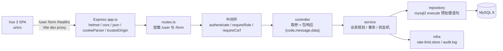

| 层 | 目录 | 职责 |
| --- | --- | --- |
| 入口 / 中间件 | [server/src/app.ts:13](server/src/app.ts#L13) | helmet、CORS（带 credentials）、body 限制、cookieParser、Origin 校验 |
| 路由 | [server/src/routes.ts:10](server/src/routes.ts#L10) | `/healthz`、`/user`、`/form` 三块 |
| 认证模块 | [server/src/user/](server/src/user) | 注册、验证码、登录、刷新、登出、OAuth、改密 |
| 表单模块 | [server/src/form/](server/src/form) | 表单配置、申请单 CRUD、状态机、名额、列表/详情 |
| 数据访问 | [server/src/db/pool.ts:28](server/src/db/pool.ts#L28) | 连接池 + `withTransaction`（自动 commit/rollback/release） |
| 迁移 | [server/src/db/migrations/](server/src/db/migrations) | 001 基础 → 002 RBAC → 003 表单 → 004 参考数据 → 005 导师 → 006 名额 |
| 前端 | [ui/src/](ui/src) | 路由表见 [ui/src/router/routes.ts:37](ui/src/router/routes.ts#L37) |

**讲这一页时说一句**：所有业务模块都是 `routes → controller → service → repository` 的单向依赖；权限判断分两层，路由层粗筛、服务层精筛。

---

## 1. 注册流程 / RBAC / Token 生成

### 1.1 讲解提纲

1. 注册接口**永远返回 202**，不区分邮箱是否存在 → 防账号枚举。
2. 角色只有一个字段 `users.role`（student / admin / supervisor），**不进 JWT**，每次请求读库 → 降权即时生效。
3. 登录成功后下发 3 个 Cookie：`access`（JWT，15 分钟）、`refresh`（不透明随机串，7 天，按 family 轮换）、`csrf`（双提交校验用）。

### 1.2 RBAC 设计

**结论**：不做 `role / permission` 表，角色是 `users` 表上的一个字段，权限规则是代码里的常量。

- 表结构（VARCHAR + CHECK，加角色只改 CHECK，不重建表）：[002_rbac.sql:12](server/src/db/migrations/002_rbac.sql#L12)、[002_rbac.sql:18](server/src/db/migrations/002_rbac.sql#L18)
- 新账号角色写死默认 `student`，**注册接口永不接受 role 字段**：[user.repository.ts:52](server/src/user/user.repository.ts#L52)
- zod `.strict()` 让多传 `role` 直接 400：[user.schema.ts:21](server/src/user/user.schema.ts#L21)
- 预置 admin / supervisor 走 bootstrap 幂等 seed：[server/src/bootstrap/accounts.ts:78](server/src/bootstrap/accounts.ts#L78)

**两层鉴权**：

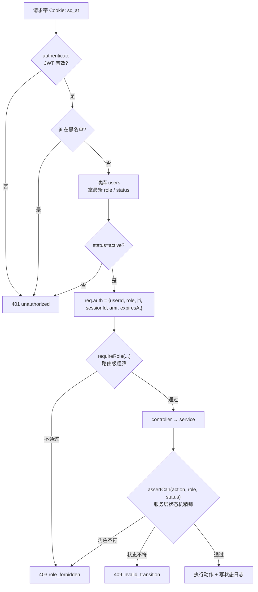

- `authenticate`（认证只认 token，role 是为了拿最新状态才读库）：[authenticate.ts:49](server/src/middleware/authenticate.ts#L49)
- `resolveAuthContext`（黑名单 + 读库）：[authenticate.ts:22](server/src/middleware/authenticate.ts#L22)
- `requireRole`（路由级）：[authorize.ts:16](server/src/middleware/authorize.ts#L16)
- `assertCan`（服务级）：[application.state.ts:121](server/src/form/application.state.ts#L121)
- 越权（IDOR）单独拦：学生只能操作自己的申请 → [application.state.ts:155](server/src/form/application.state.ts#L155)

### 1.3 注册时序图

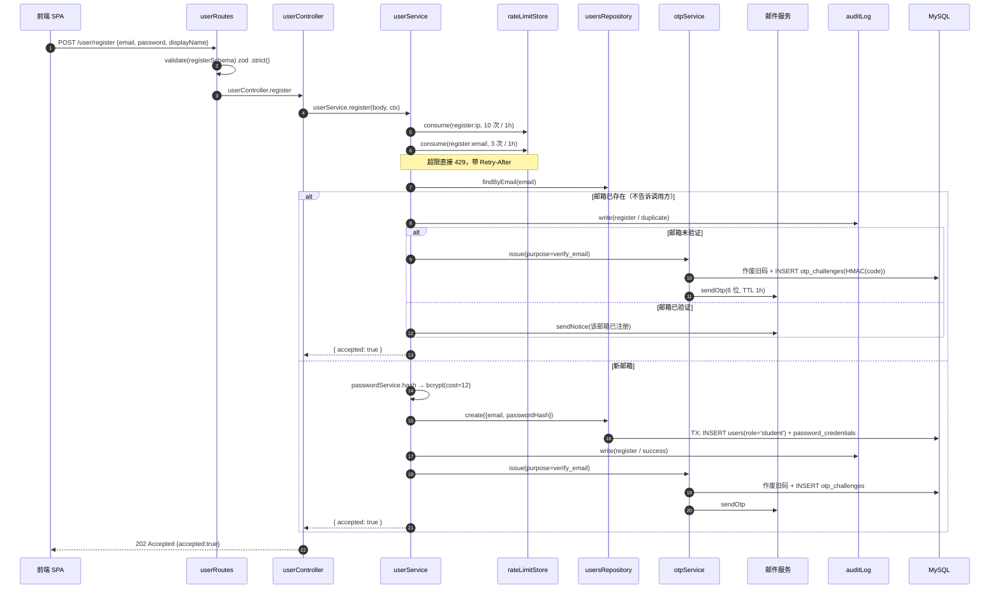

**逐步骤代码位置**

| # | 步骤 | 代码 |
| --- | --- | --- |
| 1 | 路由声明 | [user.routes.ts:31](server/src/user/user.routes.ts#L31) |
| 2 | 请求体校验（zod `.strict()`） | [user.schema.ts:21](server/src/user/user.schema.ts#L21) |
| 3 | `validate` 中间件 | [validate.ts:17](server/src/common/validate.ts#L17) |
| 4 | controller，固定 202 | [user.controller.ts:40](server/src/user/user.controller.ts#L40) |
| 5 | 注册主逻辑（限流 → 查重 → 建号 → 发码） | [user.service.ts:87](server/src/user/user.service.ts#L87) |
| 6 | 限流桶 | [rate-limit.store.ts:22](server/src/infra/rate-limit.store.ts#L22) |
| 7 | 事务内建 users + password_credentials | [user.repository.ts:37](server/src/user/user.repository.ts#L37) |
| 8 | 密码哈希（bcrypt 12） | [password.service.ts:15](server/src/user/auth/password.service.ts#L15) |
| 9 | 注册邮件（失败不抛，避免「已建号却 500」） | [user.service.ts:65](server/src/user/user.service.ts#L65) |
| 10 | 审计写入（失败只告警） | [audit.log.ts:34](server/src/infra/audit.log.ts#L34) |
| 11 | 发验证码（冷却 + 作废旧码 + HMAC 落库） | [otp.service.ts:38](server/src/user/auth/otp.service.ts#L38) |

> 讲这里补一句：`users` 表有唯一索引，并发重复注册时数据库抛 1062，仓储层翻译成 409 `email_taken`；service 层则把它降级成 202，保证外部看不出差异。

### 1.4 邮箱验证码机制

- 码不落明文：`HMAC-SHA256(OTP_SECRET, purpose:email:code)` → [otp.service.ts:13](server/src/user/auth/otp.service.ts#L13)
- 校验：过期 / 尝试次数 / 常量时间比较 / 消费（并发只能成功一次）→ [otp.service.ts:85](server/src/user/auth/otp.service.ts#L85)
- 验证接口：限流 30 次 / 15 分钟 → 校验码 → `markEmailVerified` → [user.service.ts:146](server/src/user/user.service.ts#L146)
- OTP 参数（TTL 1h、重发冷却 60s、最多 5 次）：[server/.env.example:46](server/.env.example#L46)

### 1.5 登录时序图

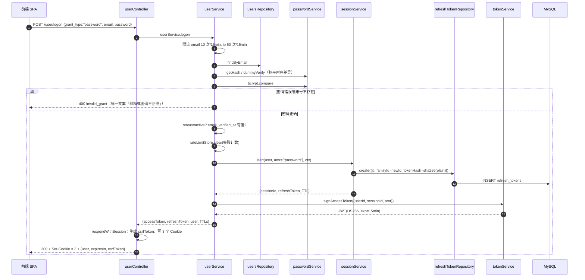

| # | 步骤 | 代码 |
| --- | --- | --- |
| 1 | 路由（两种 grant_type） | [user.routes.ts:34](server/src/user/user.routes.ts#L34) |
| 2 | 登录分支 | [user.service.ts:216](server/src/user/user.service.ts#L216) |
| 3 | 密码登录实现 | [user.service.ts:348](server/src/user/user.service.ts#L348) |
| 4 | 验证码登录实现（首次登录自动开户） | [user.service.ts:412](server/src/user/user.service.ts#L412) |
| 5 | 时序攻击防护 | [password.service.ts:31](server/src/user/auth/password.service.ts#L31) |
| 6 | 统一签发入口 | [user.service.ts:39](server/src/user/user.service.ts#L39) |

### 1.6 Token 生成与下发

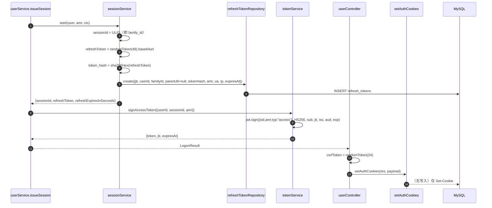

**Access Token Claims**

| Claim | 值 | 用途 |
| --- | --- | --- |
| `sub` | users.id（ULID） | 用户标识 |
| `jti` | UUID | 登出黑名单键 |
| `sid` | refresh family id | 一个会话 = 一条 family |
| `amr` | `["password"]` / `["otp"]` / `["github"]` | 登录方式，改密时判「本次是否 OTP 登录」 |
| `iss` / `aud` | `summer-camp` / `summer-camp-web` | 校验 |
| `exp` | 900s | 短期 |

> **注意 `role` 不在 token 里** —— 这是刻意的：管理员把某人降权后，下一个请求立刻生效，不用等 15 分钟 token 过期。

**三个 Cookie 的分工**

| Cookie | HttpOnly | SameSite | Path | 生命周期 | 说明 |
| --- | --- | --- | --- | --- | --- |
| `sc_at` | ✅ | Lax | `/` | 15 min | access JWT，JS 读不到，防 XSS 窃取 |
| `sc_rt` | ✅ | Strict | `/user/token` | 7 day | refresh，只在刷新接口被携带 |
| `sc_csrf` | ❌ | Strict | `/` | 7 day | 故意可读，SPA 放进 `X-CSRF-Token` 头 |

| 代码 | 位置 |
| --- | --- |
| JWT 签发 | [token.service.ts:56](server/src/user/auth/token.service.ts#L56) |
| JWT 校验（签名/过期/iss/aud 一律不区分原因） | [token.service.ts:83](server/src/user/auth/token.service.ts#L83) |
| 会话（family）创建 | [session.service.ts:63](server/src/user/auth/session.service.ts#L63) |
| refresh token 落库 | [refresh-token.repository.ts:21](server/src/user/auth/refresh-token.repository.ts#L21) |
| Cookie 下发 | [cookies.ts:20](server/src/user/auth/cookies.ts#L20) |
| 响应组装（body 里额外回 csrfToken） | [user.controller.ts:20](server/src/user/user.controller.ts#L20) |

### 1.7 每个受保护请求的鉴权链

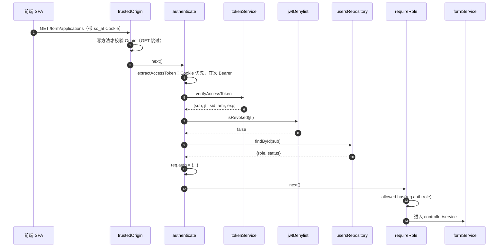

| 组件 | 位置 |
| --- | --- |
| Cookie / Bearer 双取 | [authenticate.ts:10](server/src/middleware/authenticate.ts#L10) |
| 认证主体 | [authenticate.ts:49](server/src/middleware/authenticate.ts#L49) |
| jti 黑名单 | [denylist.repository.ts:15](server/src/user/auth/denylist.repository.ts#L15) |
| 角色粗筛 | [authorize.ts:16](server/src/middleware/authorize.ts#L16) |
| Origin 校验（CSRF 第一道） | [trusted-origin.ts:20](server/src/middleware/trusted-origin.ts#L20) |
| CSRF 双提交 | [csrf.ts:14](server/src/middleware/csrf.ts#L14) |

### 1.8 刷新 / 旋转 / 复用检测

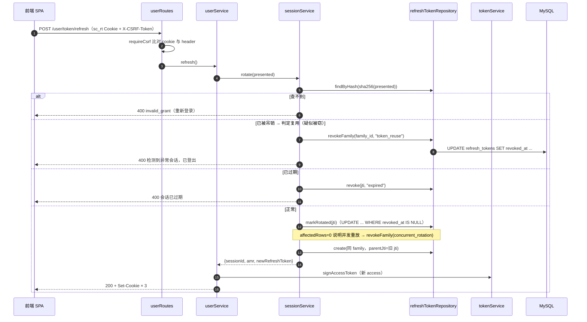

| 步骤 | 代码 |
| --- | --- |
| 刷新接口 | [user.routes.ts:36](server/src/user/user.routes.ts#L36) |
| 刷新服务 | [user.service.ts:223](server/src/user/user.service.ts#L223) |
| 旋转 + 复用检测 | [session.service.ts:81](server/src/user/auth/session.service.ts#L81) |
| 原子旋转（防并发） | [refresh-token.repository.ts:50](server/src/user/auth/refresh-token.repository.ts#L50) |
| 吊销整个 family | [refresh-token.repository.ts:66](server/src/user/auth/refresh-token.repository.ts#L66) |

### 1.9 登出

1. 吊销整条 refresh family：[session.service.ts:134](server/src/user/auth/session.service.ts#L134) → [refresh-token.repository.ts:66](server/src/user/auth/refresh-token.repository.ts#L66)
2. 把当前 access 的 `jti` 拉黑（access 是不透明失效的，只能靠黑名单）：[denylist.repository.ts:23](server/src/user/auth/denylist.repository.ts#L23)
3. 清 3 个 Cookie + 204：[user.controller.ts:80](server/src/user/user.controller.ts#L80)

> 改密码更进一步：踢掉除当前会话外的所有会话 → [user.service.ts:294](server/src/user/user.service.ts#L294) + [session.service.ts:139](server/src/user/auth/session.service.ts#L139)

### 1.10 安全设计清单

| 攻击面 | 处理 | 代码 |
| --- | --- | --- |
| 账号枚举 | 注册/发码统一 202，登录错误文案统一 | [user.service.ts:87](server/src/user/user.service.ts#L87) |
| 暴力破解 | 按 IP + 邮箱分桶限流 | [rate-limit.store.ts:22](server/src/infra/rate-limit.store.ts#L22) |
| 时序侧信道 | 账号不存在也跑一次 bcrypt compare | [password.service.ts:31](server/src/user/auth/password.service.ts#L31) |
| 验证码撞库 | 6 位码、5 次尝试、HMAC 落库、一次消费 | [otp.service.ts:85](server/src/user/auth/otp.service.ts#L85) |
| XSS 偷 token | access / refresh 都 HttpOnly | [cookies.ts:20](server/src/user/auth/cookies.ts#L20) |
| CSRF | SameSite + Origin 校验 + 双提交 Cookie | [trusted-origin.ts:20](server/src/middleware/trusted-origin.ts#L20)、[csrf.ts:14](server/src/middleware/csrf.ts#L14) |
| 越权 | requireRole 粗筛 + assertCan 精筛 + assertOwnership | [authorize.ts:16](server/src/middleware/authorize.ts#L16)、[application.state.ts:155](server/src/form/application.state.ts#L155) |
| 密码存储 | bcrypt cost 12，独立 `password_credentials` 表 | [password.service.ts:15](server/src/user/auth/password.service.ts#L15) |
| 审计 | 登录/注册/改密/登出全事件落 `auth_audit` | [audit.log.ts:34](server/src/infra/audit.log.ts#L34) |

---

## 2. 申请表单生命周期

> 这里说的「表格」= Application Form（申请表）。一条记录从 **Draft → 初筛 → 导师审核 → Offer → 学生确认** 共 9 个状态、10 个动作。

### 2.1 状态机

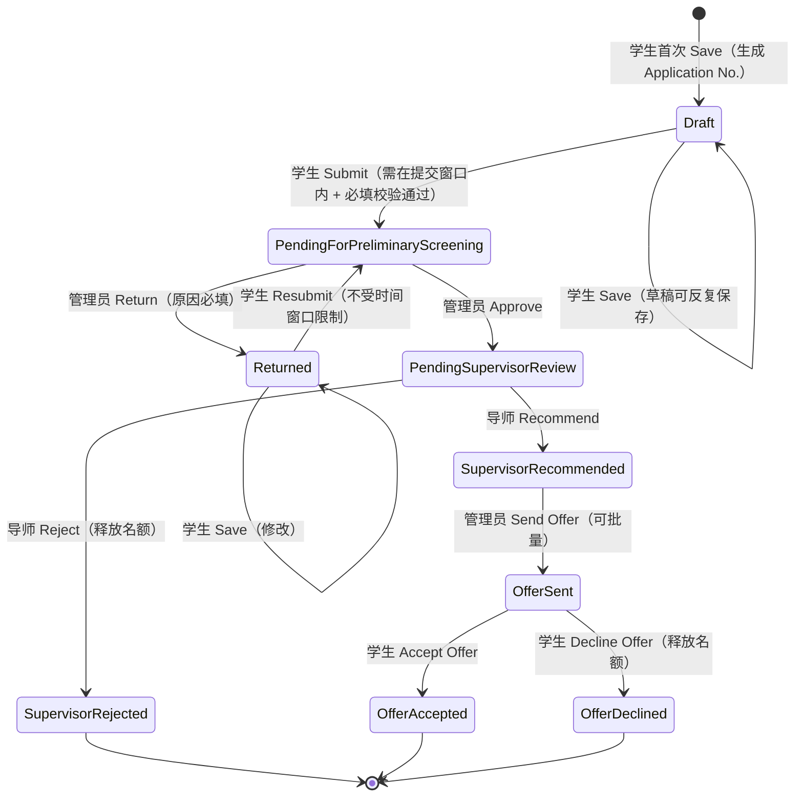

**这张表就是代码**：`TRANSITIONS` 常量定义了每个动作的 `roles / from / to / create`，路由、前端按钮、服务层校验全部从这里读。

| 动作 | 角色 | 起始状态 | 目标状态 | 代码 |
| --- | --- | --- | --- | --- |
| `save` | student | Draft / Returned / 不存在(create) | 不变 | [application.state.ts:50](server/src/form/application.state.ts#L50) |
| `submit` | student | Draft | PendingForPreliminaryScreening | [application.state.ts:56](server/src/form/application.state.ts#L56) |
| `resubmit` | student | Returned | PendingForPreliminaryScreening | [application.state.ts:61](server/src/form/application.state.ts#L61) |
| `return` | admin | PendingForPreliminaryScreening | Returned | [application.state.ts:66](server/src/form/application.state.ts#L66) |
| `approve` | admin | PendingForPreliminaryScreening | PendingSupervisorReview | [application.state.ts:71](server/src/form/application.state.ts#L71) |
| `recommend` | supervisor | PendingSupervisorReview | SupervisorRecommended | [application.state.ts:76](server/src/form/application.state.ts#L76) |
| `reject` | supervisor | PendingSupervisorReview | SupervisorRejected | [application.state.ts:81](server/src/form/application.state.ts#L81) |
| `send_offer` | admin | SupervisorRecommended | OfferSent | [application.state.ts:86](server/src/form/application.state.ts#L86) |
| `accept_offer` | student | OfferSent | OfferAccepted | [application.state.ts:91](server/src/form/application.state.ts#L91) |
| `decline_offer` | student | OfferSent | OfferDeclined | [application.state.ts:96](server/src/form/application.state.ts#L96) |

- 纯查询版本（前端按钮显隐/单测）：[application.state.ts:105](server/src/form/application.state.ts#L105)
- 会抛异常的闸门版本（服务层）：[application.state.ts:121](server/src/form/application.state.ts#L121)
- 状态枚举：[application.state.ts:15](server/src/form/application.state.ts#L15)

**数据可见范围（同一套 RBAC 的第二维：行级）**

| 角色 | 能看到的申请 |
| --- | --- |
| student | 只有自己那一份（列表 `ownerUserId` 收窄） |
| supervisor | 只有 `reviewer_supervisor_id = 自己` 且状态 ≥ PendingSupervisorReview 的；其余一律 404 防探测 |
| admin | 全部 |

实现：[form.service.ts:374](server/src/form/form.service.ts#L374)（`resolveScope`）、[form.display.ts:52](server/src/form/form.display.ts#L52)（导师可见状态集合）、[form.service.ts:426](server/src/form/form.service.ts#L426)（详情页 404 处理）

### 2.2 全流程流程图

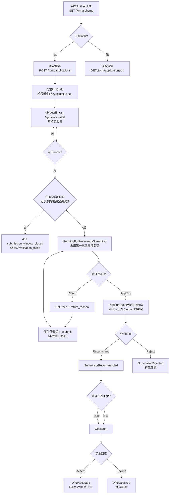

### 2.3 首次 Save → Draft 时序图

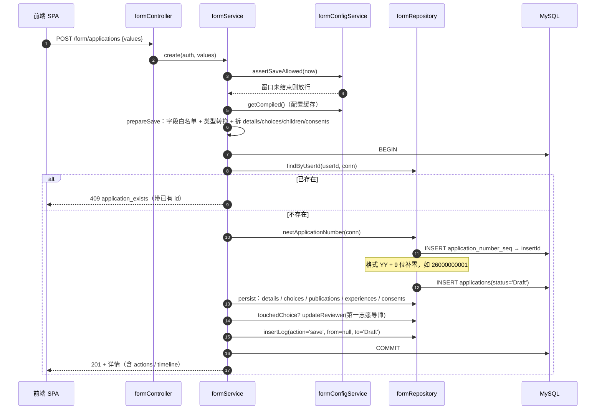

| 步骤 | 代码 |
| --- | --- |
| 路由（student + CSRF） | [form.routes.ts:47](server/src/form/form.routes.ts#L47) |
| controller | [form.controller.ts:59](server/src/form/form.controller.ts#L59) |
| 创建主流程 | [form.service.ts:494](server/src/form/form.service.ts#L494) |
| Application No. 发号（自增表，避免 MAX+1 重号） | [form.repository.ts:136](server/src/form/form.repository.ts#L136) |
| 插入主记录 | [form.repository.ts:145](server/src/form/form.repository.ts#L145) |
| 写状态日志 | [form.repository.ts:227](server/src/form/form.repository.ts#L227) |
| 返回详情（服务端算好 actions） | [form.service.ts:426](server/src/form/form.service.ts#L426) |

> 为什么发号要用独立自增表：`MAX(number)+1` 在并发下会重号，`INSERT ... SELECT MAX+1` 又要额外锁；直接用 InnoDB 的 AUTO_INCREMENT 最省事。

### 2.4 Submit 时序图（核心）

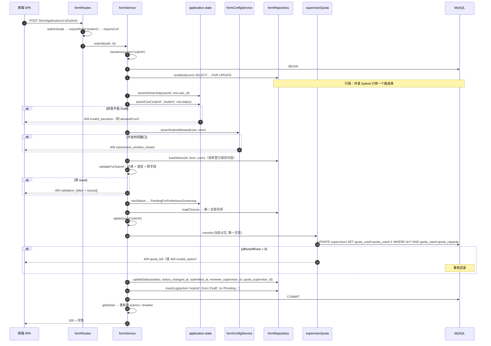

| # | 步骤 | 代码 |
| --- | --- | --- |
| 1 | 路由 | [form.routes.ts:53](server/src/form/form.routes.ts#L53) |
| 2 | controller | [form.controller.ts:73](server/src/form/form.controller.ts#L73) |
| 3 | submit（含窗口前置校验） | [form.service.ts:580](server/src/form/form.service.ts#L580) |
| 4 | **统一流转入口 transition** | [form.service.ts:860](server/src/form/form.service.ts#L860) |
| 5 | 行锁 `FOR UPDATE` | [form.repository.ts:190](server/src/form/form.repository.ts#L190) |
| 6 | 状态机精筛 | [application.state.ts:121](server/src/form/application.state.ts#L121) |
| 7 | 时间窗口 | [form.config.service.ts:240](server/src/form/form.config.service.ts#L240) |
| 8 | 提交侧完整校验 | [form.service.ts:968](server/src/form/form.service.ts#L968) |
| 9 | 下一步状态 | [form.service.ts:127](server/src/form/form.service.ts#L127) |
| 10 | 名额占位 | [form.service.ts:938](server/src/form/form.service.ts#L938) |
| 11 | 原子占位 SQL | [form.quota.ts:29](server/src/form/form.quota.ts#L29) |
| 12 | 更新状态 + 名额字段 | [form.repository.ts:198](server/src/form/form.repository.ts#L198) |
| 13 | 写日志 | [form.repository.ts:227](server/src/form/form.repository.ts#L227) |

> 强调三个「都在同一个事务里」：**改状态、占名额、写日志**。所以不会出现「提交成功但没占名额」或「占了名额但状态没改」。

### 2.5 审核链路时序图

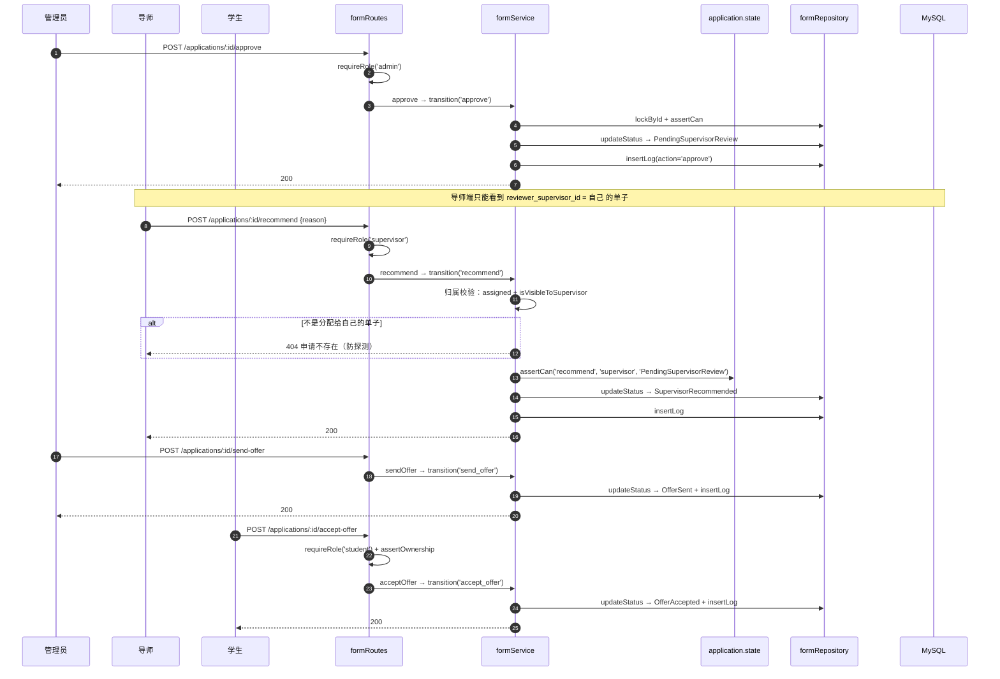

| 动作 | 路由 | controller | service |
| --- | --- | --- | --- |
| Approve | [form.routes.ts:82](server/src/form/form.routes.ts#L82) | [form.controller.ts:85](server/src/form/form.controller.ts#L85) | [form.service.ts:592](server/src/form/form.service.ts#L592) |
| Return（原因必填） | [form.routes.ts:89](server/src/form/form.routes.ts#L89) | [form.controller.ts:91](server/src/form/form.controller.ts#L91) | [form.service.ts:596](server/src/form/form.service.ts#L596) |
| Recommend | [form.routes.ts:104](server/src/form/form.routes.ts#L104) | [form.controller.ts:98](server/src/form/form.controller.ts#L98) | [form.service.ts:600](server/src/form/form.service.ts#L600) |
| Reject | [form.routes.ts:111](server/src/form/form.routes.ts#L111) | [form.controller.ts:105](server/src/form/form.controller.ts#L105) | [form.service.ts:604](server/src/form/form.service.ts#L604) |
| Send Offer | [form.routes.ts:96](server/src/form/form.routes.ts#L96) | [form.controller.ts:112](server/src/form/form.controller.ts#L112) | [form.service.ts:608](server/src/form/form.service.ts#L608) |
| Accept | [form.routes.ts:67](server/src/form/form.routes.ts#L67) | [form.controller.ts:118](server/src/form/form.controller.ts#L118) | [form.service.ts:612](server/src/form/form.service.ts#L612) |
| Decline | [form.routes.ts:74](server/src/form/form.routes.ts#L74) | [form.controller.ts:124](server/src/form/form.controller.ts#L124) | [form.service.ts:616](server/src/form/form.service.ts#L616) |

### 2.6 批量 Send Offer

- 入口：[form.routes.ts:119](server/src/form/form.routes.ts#L119) → [form.service.ts:624](server/src/form/form.service.ts#L624)
- 去重 → **并发上限 10** → **单条超时 3s** → 每条独立事务
- 返回 `{total, successCount, failureCount, failures[]}`，失败项带 `applicationNumber + code + message`
- 实现细节：`withTimeout` + `mapWithConcurrency`（同一个文件，[form.service.ts:254](server/src/form/form.service.ts#L254)）

> 讲点：批量不是「一个大事务」，否则一条失败全批回滚；也不是串行，否则 100 条要等很久。折中是「并发 + 单条超时 + 汇总失败原因」。

### 2.7 名额并发控制

核心一句：**用条件原子 UPDATE，不做「先 SELECT 再 UPDATE」**。

```sql
UPDATE supervisors
   SET quota_used = quota_used + 1
 WHERE id = ? AND quota_used < quota_capacity
```

- 实现：[form.quota.ts:29](server/src/form/form.quota.ts#L29)
- affectedRows = 0 → 再查一次只为区分「名额满 409」还是「导师不存在 400」
- 换导师：`transfer` 按 supervisor id 升序加锁，避免 A→B / B→A 死锁：[form.quota.ts:91](server/src/form/form.quota.ts#L91)
- 释放是幂等的（`AND quota_used > 0`）：[form.quota.ts:72](server/src/form/form.quota.ts#L72)
- 表级 CHECK 兜底：[003_application_schema.sql:70](server/src/db/migrations/003_application_schema.sql#L70)
- 名额字段：[006_supervisor_quota.sql:25](server/src/db/migrations/006_supervisor_quota.sql#L25)

**释放时机**：导师 Reject / 学生 Decline Offer；**Returned 期间继续占位**（学生还有机会改）；Accept 后转为最终占用。

### 2.8 提交时间窗口

| 规则 | 代码 |
| --- | --- |
| 查询当前/下一个窗口 | [form.config.service.ts:206](server/src/form/form.config.service.ts#L206) |
| 草稿是否还能保存（没配窗口 = 不限制） | [form.config.service.ts:225](server/src/form/form.config.service.ts#L225) |
| Save 越界 → 409 `submission_window_closed` | [form.config.service.ts:234](server/src/form/form.config.service.ts#L234) |
| Submit 越界 → 409（Resubmit 不检查） | [form.config.service.ts:240](server/src/form/form.config.service.ts#L240) |
| 纯函数版本（可单测） | [application.state.ts:187](server/src/form/application.state.ts#L187) |
| 窗口表 | [003_application_schema.sql:207](server/src/db/migrations/003_application_schema.sql#L207) |

### 2.9 状态 → 展示文案

同一个内部状态，学生端和员工端文案不同（学生看到的是业务语义，初筛和导师审核折叠成同一个 `Under Review`）。

| 内部状态 | 学生端 | 管理/导师端 |
| --- | --- | --- |
| Draft | Draft | Draft |
| PendingForPreliminaryScreening | Under Review | Pending For Preliminary Screening |
| Returned | Pending for Update | Returned |
| PendingSupervisorReview | Under Review | Pending Supervisor Review |
| SupervisorRecommended | Recommended | Supervisor Recommended |
| SupervisorRejected | Rejected | Supervisor Rejected |
| OfferSent | Pending for Offer Acceptance | Offer Sent |
| OfferAccepted | Offer Accepted | Offer Accepted |
| OfferDeclined | Offer Declined | Offer Declined |

实现：[form.display.ts:45](server/src/form/form.display.ts#L45)。响应里同时给 `status`（前端判断用）和 `displayStatus`（展示用）。

### 2.10 数据模型

| 表 | 作用 | 位置 |
| --- | --- | --- |
| `applications` | 工作流主体（状态、评审人、名额占位、Application No.） | [003_application_schema.sql:233](server/src/db/migrations/003_application_schema.sql#L233) |
| `application_number_seq` | 发号器（AUTO_INCREMENT） | [003_application_schema.sql:226](server/src/db/migrations/003_application_schema.sql#L226) |
| `application_status_logs` | 状态时间线 / 审计 | [003_application_schema.sql:505](server/src/db/migrations/003_application_schema.sql#L505) |
| `form_sections` / `form_fields` / `form_field_options` | **表单配置数据化**：加字段改数据，不改代码 | [003_application_schema.sql:148](server/src/db/migrations/003_application_schema.sql#L148) |
| `application_details` | 1:1 明细（列表页不扫这张宽表） | 见 003 |
| `application_program_choices` | 两个志愿 + 导师 | 见 003 |
| `supervisors` | 导师档案 + `quota_capacity` / `quota_used` | [003_application_schema.sql:44](server/src/db/migrations/003_application_schema.sql#L44) |
| `submission_windows` | 提交时间段 | [003_application_schema.sql:207](server/src/db/migrations/003_application_schema.sql#L207) |

> 亮点句：**表单是配置驱动的** —— `GET /form/schema` 从 `form_sections/fields/options` 拼出前端要渲染的结构（[form.service.ts:298](server/src/form/form.service.ts#L298)），所以新增一个字段是插一行数据，不是改前端 + 改后端 + 发版。

---

## 3. 现场演示脚本

### 3.1 启动

```bash
# 后端：mysql + migrate + server
cd d:/develop/summer-camp
docker compose up -d --build

# 前端
cd ui
npm run dev      # http://localhost:5173
```

> Vite 已把 `/user`、`/form`、`/healthz` 代理到 `:3000`，浏览器视角同源，Cookie / CSRF 不用额外配置。

### 3.2 演示顺序（建议 5 分钟）

| 步骤 | 操作 | 讲解点 |
| --- | --- | --- |
| 1 | 打开 `/login`，用学生邮箱注册 | 响应 202；邮箱已存在也是 202（防枚举） |
| 2 | 从后端日志/SMTP 拿 6 位码，完成邮箱验证 | `HMAC` 落库，库里看不到明文码 |
| 3 | 登录，打开 DevTools → Application → Cookies | 三个 Cookie，两个 HttpOnly，`sc_rt` 的 Path 是 `/user/token` |
| 4 | 再点一次刷新（或等 access 过期），看 Network | `/user/token/refresh` 返回新的 `sc_at`，refresh 轮换了 |
| 5 | 学生填表 → Save | 状态 Draft，列表出现 Application No. |
| 6 | 学生 Submit | 状态 Pending For Preliminary Screening，导师名额 +1 |
| 7 | 管理员 approve | 转 Pending Supervisor Review |
| 8 | 导师 recommend | 转 Supervisor Recommended |
| 9 | 管理员 send-offer（可试批量） | 转 Offer Sent |
| 10 | 学生 accept-offer | 转 Offer Accepted |
| 11 | 打开详情时间线 | `GET /form/applications/:id/history` 每一步都有 actor/role/remark |

### 3.3 预置账号（`.env` 的 bootstrap）

| 角色 | 邮箱 | 密码 |
| --- | --- | --- |
| admin | `admin@example.com` | `1234567890123456` |
| supervisor | `supervisor002@example.com` | `1234567890123456` |
| supervisor | `supervisor032@example.com` | `1234567890123456` |

> 预置账号是幂等 seed：已存在不会覆盖密码；导师账号会自动绑定 `supervisors.user_id`，否则导师端列表永远是空的。

### 3.4 可以现场跑的自动化

```bash
cd server
npm run typecheck
npm run smoke        # 认证链路
npm run smoke:form   # 表单全流程
npm run smoke:quota  # 名额并发
```

---

## 附录：Q&A 预案

**Q1：为什么 role 不放进 JWT？**
A：放进去就要等 token 过期才能降权。这里 `authenticate` 每请求读一次 `users`，多一次主键查询换「降权/封禁立即生效」。JWT 只负责证明「你是谁、哪个会话、用什么方式登录」。

**Q2：access token 为什么不透明化，还要 JWT？**
A：access 是短期的（15 分钟），用 JWT 可以少一次存储查询做签名校验；refresh 才需要可撤销，所以用了「随机串 + 数据库 + family 轮换」。

**Q3：刷新为什么每次都要换 refresh token？**
A：轮换 + 复用检测。旧 token 被第二次使用说明可能泄露，直接把整个 family 吊销（[session.service.ts:81](server/src/user/auth/session.service.ts#L81)）。

**Q4：为什么权限规则写在代码里，不做权限表？**
A：状态机和角色矩阵是**固定的业务规则**，跟着代码一起 review、一起测试、一起回滚。做成表会出现「数据和代码不同步」，而且本项目角色只有 3 个。真要动态化，替换 `TRANSITIONS` 的读取来源即可，调用方不用改。

**Q5：两层鉴权是不是重复？**
A：不重复。路由层 `requireRole` 只回答「这个角色能不能碰这个接口」，快速 403；服务层 `assertCan` 回答「这条记录当前状态能不能做这个动作」，还要结合归属、可见性、时间窗口、名额。少任何一层都会漏。

**Q6：Submit 为什么在事务里再读一次 values？**
A：校验的必须是**库里已保存的内容**，不是请求体。同时事务内所有读取复用同一个 `conn`，避免持锁期间再去连接池借连接。

**Q7：名额为什么放 supervisors 表而不是单独一张表？**
A：占用是高频、强一致的计数，放在导师行上可以直接用 InnoDB 行锁 + 条件 UPDATE 做原子占位；`applications.quota_supervisor_id` 作为「事实来源」，006 迁移里有从明细重算计数器的脚本。

**Q8：状态文案为什么要分学生/员工两套？**
A：学生不需要知道「初筛」和「导师审核」的区别，只需要知道 Under Review；管理端需要精确状态去做操作。所以内部状态保持 9 个不变，展示层做映射（[form.display.ts:45](server/src/form/form.display.ts#L45)）。

---

### 一页速查：关键文件

| 关注点 | 文件 |
| --- | --- |
| 中间件装配 | [server/src/app.ts](server/src/app.ts) |
| 认证路由 | [server/src/user/user.routes.ts](server/src/user/user.routes.ts) |
| 认证业务 | [server/src/user/user.service.ts](server/src/user/user.service.ts) |
| JWT / 会话 | [server/src/user/auth/token.service.ts](server/src/user/auth/token.service.ts)、[session.service.ts](server/src/user/auth/session.service.ts) |
| RBAC + 状态机 | [server/src/form/application.state.ts](server/src/form/application.state.ts) |
| 表单业务 | [server/src/form/form.service.ts](server/src/form/form.service.ts) |
| 名额 | [server/src/form/form.quota.ts](server/src/form/form.quota.ts) |
| 表结构 | [server/src/db/migrations/](server/src/db/migrations) |
