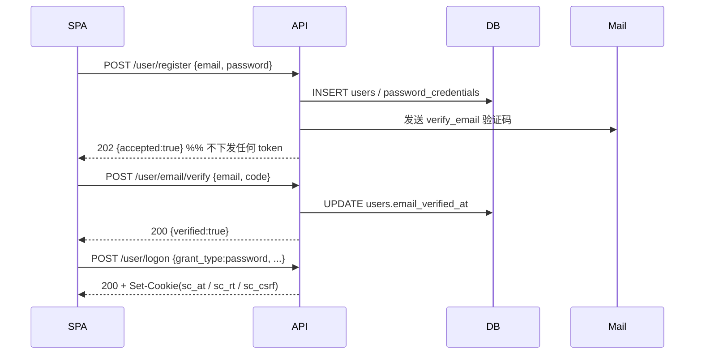
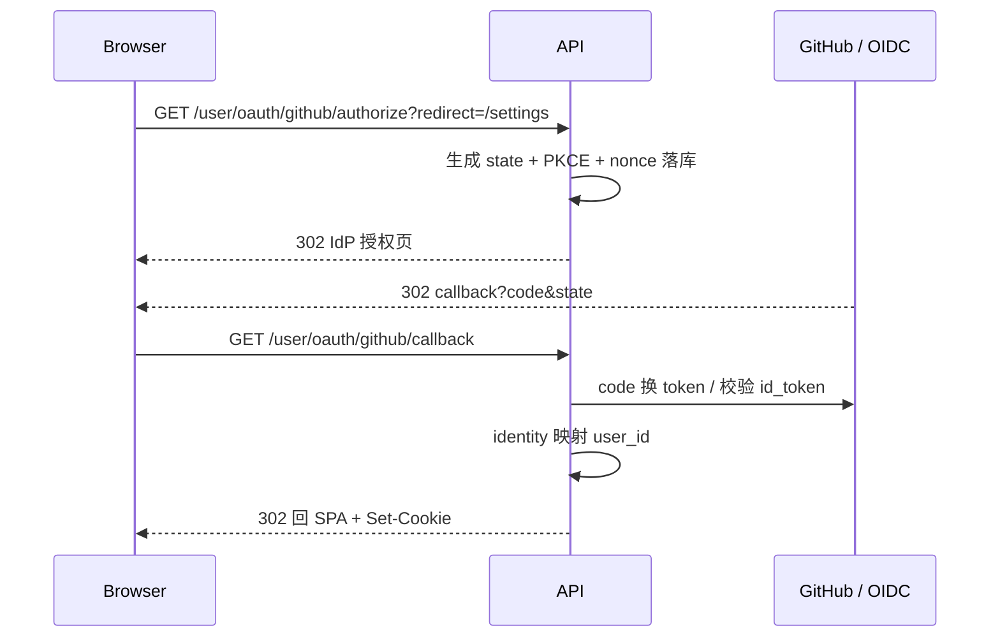

# Summer Camp · 服务端

Express + TypeScript 服务端，按业务域拆成两个模块：

| 模块 | 前缀 | 说明 |
| --- | --- | --- |
| 认证 | `/user` | 登录 / 注册 / 验证码 / 刷新 / 登出 / 第三方登录 |
| 申请表 | `/form` | 表单配置、申请单保存与提交、学生/管理员/导师三端状态流转、批量发送 Offer |

认证模块支持三种身份来源，最终都收敛为「本系统 user_id + JWT（HttpOnly Cookie）」：

| 身份来源 | 状态 | 说明 |
| --- | --- | --- |
| 邮箱 + 密码 | ✅ 已实现 | 注册后需验证邮箱 |
| 邮箱 + 一次性验证码（OTP） | ✅ 已实现 | 首次登录自动开户 |
| 第三方（GitHub OAuth2 / 通用 OIDC） | ✅ 提供扩展点 | 微信可作为下一个实现接入 |

---

## 1. 技术栈

- Express 4 + TypeScript（`strict`）
- MySQL 8 + `mysql2/promise`（全部走预处理语句）
- `zod` 请求校验 / `pino` 结构化日志 / `helmet` + `cors`
- `jsonwebtoken`（HS256，可按需换 RS256 + JWKS）
- `bcryptjs`（纯 JS，免编译）+ `nodemailer`
- `jose`（校验 OIDC 的 id_token）

---

## 2. 快速开始

```bash
cd server
cp .env.example .env      # 按需修改 MySQL / 密钥
npm install
npm run migrate           # 自动建库建表
npm run dev               # http://localhost:3000
npm run smoke             # 另开终端，跑端到端冒烟测试
```

没有本地 MySQL？用 Docker 起一个：

```bash
docker run -d --name summer-camp-mysql \
  -e MYSQL_ROOT_PASSWORD=devpass \
  -e MYSQL_DATABASE=summer_camp \
  -p 3306:3306 mysql:8.4
# .env 里把 MYSQL_PASSWORD 改成 devpass
```

> 未配置 `SMTP_HOST` 时，验证码会以 `[DEV MAIL]` 的形式打印在服务端日志里，方便本地调试。

### 预置账号（Admin / Supervisor）

线上用镜像部署时不需要人工注册再改库——启动时会按环境变量幂等创建：

| 变量 | 说明 |
| --- | --- |
| `BOOTSTRAP_ON_START` | `true` 时在 `listen` 之前执行 seed；多副本部署请设为 `false`，改用 Job |
| `BOOTSTRAP_ADMIN_EMAIL` / `BOOTSTRAP_ADMIN_PASSWORD` | 唯一管理员 |
| `BOOTSTRAP_SUPERVISOR_1_EMAIL` / `_PASSWORD` | 督导 1 |
| `BOOTSTRAP_SUPERVISOR_2_EMAIL` / `_PASSWORD` | 督导 2 |
| `*_PASSWORD_FILE` | 可选，指向 Docker secret / k8s Secret 文件，优先于明文变量 |
| `BOOTSTRAP_ENFORCE_ROLE` | 已有账号角色不一致时是否强制纠正，默认只告警 |

行为约定：

- 账号不存在 → 创建（`role` 正确、`email_verified_at` 已填，可直接密码登录）
- 账号已存在 → **永不覆盖密码**，仅补齐缺失的邮箱验证 / 密码凭证
- 账号存在但角色不符 → 默认只 WARN，避免 env 泄露变成提权通道
- 邮箱重复 / EMAIL 与 PASSWORD 不成对 / 密码不足 16 位 → 启动直接失败

手动执行（幂等，可重复）：

```bash
npm run migrate
npm run seed:accounts           # 开发（tsx 直跑源码）
node dist/bootstrap/seed-cli.js # 生产镜像（无 devDependencies）
```

Docker 镜像里两种接法（任选其一）：

```bash
# A. 启动时自动 seed
BOOTSTRAP_ON_START=true node dist/index.js

# B. 多副本：seed 只跑一次，再关掉开关
node dist/bootstrap/seed-cli.js && BOOTSTRAP_ON_START=false node dist/index.js
```

---

## 3. 目录结构

```
server/src
├── index.ts                  # 进程入口：启动 + 优雅关闭
├── app.ts                    # express 装配（helmet / cors / cookie / 错误处理）
├── routes.ts                 # 根路由：/healthz、/user
├── config/                   # 环境变量 zod 校验，配置错误启动即失败
├── bootstrap/                # 预置 admin / supervisor 账号（幂等 seed）
├── db/
│   ├── pool.ts               # 连接池（UTC、utf8mb4、事务封装）
│   ├── migrate.ts            # 极简迁移器
│   └── migrations/           # 001 认证 / 002 RBAC / 003 申请表 / 004 参考数据 / 005 导师
├── common/                   # errors / logger / crypto / validate / http / response
├── middleware/               # authenticate / csrf / trusted-origin / error-handler
├── infra/
│   ├── rate-limit.store.ts   # 限流抽象（现在是 MySQL 实现，可换 Redis）
│   └── audit.log.ts          # auth_audit 审计
├── form/                     # ★ 申请表模块（接口见第 10 节）
│   ├── form.routes.ts        # 18 个路由，挂到 /form
│   ├── form.controller.ts    # 薄控制器：参数 -> service -> { code, message, data }
│   ├── form.service.ts       # Save / Submit / Approve / Return / Recommend / Reject / Offer
│   ├── form.repository.ts    # 申请单 + 明细 + 志愿 + 子表 + 审计日志的 SQL
│   ├── form.config.repository.ts / form.config.service.ts  # 表单配置与提交窗口（含 30s 缓存）
│   ├── form.validation.ts    # 字段级校验（类型/长度/选项/必填/联动）
│   ├── form.display.ts       # status -> displayStatus（学生端与后台端文案不同）
│   ├── form.schema.ts        # zod 入参
│   ├── form.types.ts
│   ├── supervisor.repository.ts # 导师候选检索 + 账号绑定
│   └── application.state.ts  # 状态机 + assertCan（动作/角色/状态）
└── user/                     # ★ 所有登录逻辑都在这里
    ├── user.routes.ts / user.controller.ts / user.service.ts
    ├── user.repository.ts / identity.repository.ts / user.schema.ts / user.types.ts
    ├── auth/
    │   ├── password.service.ts      # bcrypt + 时序防护
    │   ├── otp.service.ts           # 验证码签发/校验（HMAC 落库）
    │   ├── token.service.ts         # JWT 签发/校验
    │   ├── session.service.ts       # refresh token 旋转 + 复用检测
    │   ├── denylist.repository.ts   # jti 黑名单
    │   ├── cookies.ts               # HttpOnly Cookie 读写
    │   └── mail.service.ts
    └── oauth/
        ├── identity-provider.ts     # 统一接口
        ├── oauth.service.ts         # 授权码交换 + 账号映射
        ├── oauth.routes.ts
        └── providers/{github,oidc}.ts
```

---

## 4. 认证流程

### 4.1 注册 → 验证邮箱 → 密码登录



**为什么注册不直接发 token**：避免有人用别人的邮箱抢注并立刻拿到会话；只有证明邮箱归属（验证码）之后才允许登录。

### 4.2 邮箱 OTP 登录（首次自动开户）


### 4.3 刷新与登出

- `POST /user/token/refresh` 读取 `sc_rt` → **旋转**出新 refresh token，旧的立即失效
- 旧 token 再次出现 = 被窃取 → 整个 family 全部吊销（复用检测）
- `POST /user/logout` → 吊销 family + 把当前 access token 的 `jti` 写入黑名单

### 4.4 第三方登录（当前为扩展点）



账号映射规则（按优先级）：

1. `(provider, provider_user_id)` 已绑定 → 直接登录
2. 本次带 `link_user_id`（已登录用户主动绑定）→ 建立绑定
3. 否则新建账号；**若邮箱已存在则返回 `oauth_error=link_required`，绝不自动合并**

---

## 5. 接口清单（认证）

所有接口前缀 `/user`，请求/响应均为 JSON。错误统一返回 `application/problem+json`。
申请表相关接口在 `/form` 下，见 [第 10 节](#10-申请表模块form)。

| 方法 | 路径 | 说明 | 认证 |
| --- | --- | --- | --- |
| POST | `/user/register` | 注册（发验证码） | — |
| POST | `/user/otp` | 发送一次性验证码 | — |
| POST | `/user/email/verify` | 校验注册验证码 | — |
| POST | `/user/logon` | 登录（密码 / 验证码） | — |
| POST | `/user/token/refresh` | 刷新 access token | Cookie + CSRF |
| GET | `/user/csrf` | 取回 CSRF token | — |
| POST | `/user/logout` | 登出 | Cookie + CSRF |
| GET | `/user/me` | 当前用户 + 已绑定身份 | Cookie |
| POST | `/user/password/change` | 设置 / 修改密码 | Cookie + CSRF |
| GET | `/user/oauth/providers` | 可用的第三方登录 | — |
| GET | `/user/oauth/:provider/authorize` | 发起授权（`?link=1` 表示绑定） | 可选 |
| GET | `/user/oauth/:provider/callback` | 第三方回调 | — |

### 5.1 注册

```http
POST /user/register
Content-Type: application/json

{ "email": "a@b.com", "password": "Passw0rd!2024", "displayName": "Clover" }
```

```http
HTTP/1.1 202 Accepted
{ "accepted": true }
```

> 无论邮箱是否已注册都返回 202：新邮箱建号并发验证码；已注册则给邮箱所有者发提示邮件，**不会覆盖原密码**。

### 5.2 发送验证码

```http
POST /user/otp

{ "email": "a@b.com", "purpose": "logon" }   // logon | verify_email
```

```http
HTTP/1.1 202 Accepted
{ "accepted": true, "expiresInSeconds": 3600 }
```

### 5.3 登录

```http
POST /user/logon

{ "grant_type": "password", "email": "a@b.com", "password": "Passw0rd!2024" }
// 或
{ "grant_type": "otp", "email": "a@b.com", "otp": "246810" }
```

```http
HTTP/1.1 200 OK
Set-Cookie: sc_at=...; HttpOnly; Path=/; SameSite=Lax
Set-Cookie: sc_rt=...; HttpOnly; Path=/user/token; SameSite=Strict
Set-Cookie: sc_csrf=...; Path=/; SameSite=Strict

{
  "tokenType": "Bearer",
  "expiresIn": 900,
  "user": { "id": "01J...", "email": "a@b.com", "emailVerified": true, "status": "active", "displayName": null, "createdAt": "2026-11-08T..." },
  "csrfToken": "..."
}
```

**token 只放在 HttpOnly Cookie 里，响应体不返回**，前端 JS 拿不到，显著降低 XSS 窃取风险。
`csrfToken` 同时出现在响应体和可读 Cookie 中，方便前后端跨子域部署时取用。

### 5.4 刷新 / 登出

```http
POST /user/token/refresh
Cookie: sc_rt=...; sc_csrf=...
X-CSRF-Token: <与 sc_csrf 相同>
```

```http
POST /user/logout
Cookie: sc_at=...; sc_csrf=...
X-CSRF-Token: <与 sc_csrf 相同>
→ 204 No Content
```

### 5.5 其他

```http
GET /user/me
→ { "user": {...}, "identities": [{ "provider": "github", "email": "a@b.com", "createdAt": "..." }] }

POST /user/password/change
{ "currentPassword": "旧密码", "newPassword": "新密码" }
→ { "revokedSessions": 2 }
```

---

## 6. 错误码

响应体形如：

```json
{
  "type": "about:blank#invalid_grant",
  "title": "invalid_grant",
  "status": 401,
  "code": "invalid_grant",
  "detail": "邮箱或密码不正确"
}
```

| code | HTTP | 含义 |
| --- | --- | --- |
| `validation_failed` | 400 | 参数校验失败（`errors` 里有字段级明细） |
| `invalid_grant` | 401 | 凭证无效（密码错 / 验证码错 / 会话失效，不区分具体原因） |
| `unauthorized` | 401 | 未登录或 JWT 已失效或被拉黑 |
| `email_unverified` | 403 | 邮箱未验证 |
| `csrf_token_invalid` | 403 | CSRF 双提交校验失败 |
| `origin_not_allowed` | 403 | 请求来源不在白名单 |
| `forbidden` | 403 | 账号被禁用等 |
| `rate_limited` | 429 | 触发限流，响应头带 `Retry-After` |
| `internal_error` | 500 | 服务端异常（细节只写日志） |

申请表模块补充的错误码（同样走 problem+json，`code` 已提升到顶层）：

| code | HTTP | 含义 |
| --- | --- | --- |
| `invalid_transition` | 409 | 当前状态不允许该动作（`details.current` / `details.allowedFrom`） |
| `submission_window_closed` | 409 | 不在提交时间段内（Submit），或时段结束后仍尝试保存草稿 |
| `application_exists` | 409 | 同一账号重复创建申请（`details.applicationId` 指向已有申请） |
| `not_resource_owner` | 403 | 学生操作他人的申请 |
| `role_forbidden` | 403 | 当前角色无权执行该动作 |
| `supervisor_not_registered` | 403 | 导师账号尚未绑定导师档案（`supervisors.user_id`） |
| `supervisor_program_mismatch` | 400 | 所选导师不属于所选 Program |
| `duplicate_program` / `duplicate_supervisor` | 400 | 两个志愿选了同一个 Program / 同一位导师 |

---

## 7. 安全设计要点

| 项 | 做法 |
| --- | --- |
| 密码 | bcrypt cost 12；bcryptjs 纯 JS 免编译，换 argon2id 只需改 `password.service.ts` |
| 时序攻击 | 账号不存在时也执行一次 dummy compare |
| 验证码 | HMAC-SHA256 落库、6 位、1 小时、单次消费、错误 5 次作废、60 秒重发冷却 |
| 账号枚举 | 注册/发码统一 202；登录失败统一 `invalid_grant` |
| 限流 | `rate_limit_events` 滑动窗口，按 email + IP 双维度；登录成功清零 |
| JWT | HS256、`iss/aud/exp/nbf` 全校验、`jti`、`sid`、`amr`、15 分钟有效期 |
| 登出 | refresh family 吊销 + access token `jti` 黑名单 |
| Refresh 旋转 | 一次性、原子 `UPDATE ... WHERE revoked_at IS NULL`、复用即吊销全家族 |
| Cookie | `HttpOnly` + `SameSite` + 生产环境自动 `Secure`（本地 HTTP 开发不加） |
| CSRF | Origin 白名单 + 双提交 Token（`X-CSRF-Token`） |
| 第三方登录 | Authorization Code + PKCE + state + nonce；id_token 交给 `jose` 校验；**不按邮箱自动合并** |
| 审计 | `auth_audit` 记录注册/登录/发码/绑定/改密，写入失败不影响主流程 |
| 日志 | pino redact 掉 cookie、authorization、password、otp、token |

---

## 8. 多实例扩展预留

单实例部署即可运行，但下面几处已经是**接口 + 实现**分离，扩展到多实例时只需替换实现：

| 能力 | 当前实现 | 多实例方案 |
| --- | --- | --- |
| 限流计数 | `infra/rate-limit.store.ts` → MySQL | `rateLimitStore.replace(new RedisRateLimitStore())` |
| jti 黑名单 | `TokenRevocationStore` → MySQL | 换 Redis，`isRevoked` 走缓存 |
| 会话 | `refresh_tokens` 表（天然共享） | 无需改 |
| 部署 | 无状态进程 + MySQL | 直接水平扩容，记得 `app.set('trust proxy', 1)` |
| JWT 验签 | HS256 单密钥 | 换 RS256 + JWKS，多服务可独立验签 |

---

## 9. 后续可以做的事

- [ ] 忘记密码流程（`reset_password` 用途已在表结构里预留）
- [ ] 微信登录（`openid/unionid` 没有邮箱，需要先让用户在站内绑定邮箱）
- [ ] 新设备/新 IP 登录邮件提醒
- [ ] `refresh_tokens` / `jwt_denylist` / `rate_limit_events` 的定时清理任务
- [ ] 触发式人机验证（连续失败后要求）
- [ ] OpenAPI 文档（当前接口契约见本文档）

---

## 10. 申请表模块（`/form`）

字段口径来自 `附件/application-form.xlsx`（Sheet1 的 A/B/C/D 四列），状态与流转来自笔试题的「简要流程 / 状态与展示」两节。

### 10.1 数据模型

| 表 | 作用 |
| --- | --- |
| `applications` | 申请单主体：`application_number` / `status` / `reviewer_supervisor_id` / `submitted_at` / `return_reason` |
| `application_details` | 1:1 明细：个人信息、研究方向、个人陈述 |
| `application_program_choices` | 志愿（最多两条，`choice_rank` 1/2） |
| `application_publications` / `application_experiences` | 可重复小节（论文 / 经历） |
| `application_consents` | 声明勾选（记录同意的条款版本） |
| `application_status_logs` | 状态流转审计（动作 / 从哪到哪 / 谁 / 备注） |
| `programs` / `supervisors` / `document_types` / `exams` / `exam_subjects` / `statement_definitions` | 参考数据 |
| `form_sections` / `form_fields` / `form_field_options` | 表单配置（A/B/C/D 四列落成数据） |
| `submission_windows` | 提交时间段（数据库配置，需求 2.1） |

可重复小节与明细的读写**由配置驱动**：`form_fields.storage_table` + `storage_column` 决定值落在哪一列，`form_sections.payload_key` 决定可重复小节在 `values` 里的数组键。

### 10.2 状态机 ↔ 端点

| 动作 | 端点 | 角色 | 从 | 到 |
| --- | --- | --- | --- | --- |
| Create | `POST /form/applications` | student | — | `Draft` |
| Save | `PUT /form/applications/:id` | student | `Draft` / `Returned` | 不变 |
| Submit | `POST /form/applications/:id/submit` | student | `Draft` | `PendingForPreliminaryScreening` |
| Resubmit | `POST /form/applications/:id/resubmit` | student | `Returned` | `PendingForPreliminaryScreening` |
| Approve | `POST /form/applications/:id/approve` | admin | `PendingForPreliminaryScreening` | `PendingSupervisorReview` |
| Return | `POST /form/applications/:id/return` | admin | `PendingForPreliminaryScreening` | `Returned` |
| Recommend | `POST /form/applications/:id/recommend` | supervisor | `PendingSupervisorReview` | `SupervisorRecommended` |
| Reject | `POST /form/applications/:id/reject` | supervisor | `PendingSupervisorReview` | `SupervisorRejected` |
| Send Offer | `POST /form/applications/:id/send-offer`、`POST /form/offers/batch` | admin | `SupervisorRecommended` | `OfferSent` |
| Accept Offer | `POST /form/applications/:id/accept-offer` | student | `OfferSent` | `OfferAccepted` |
| Decline Offer | `POST /form/applications/:id/decline-offer` | student | `OfferSent` | `OfferDeclined` |

两层校验：路由层 `requireRole` 只挡角色；「当前状态能不能做这件事」由 `form/application.state.ts` 的 `assertCan(action, role, status)` 在服务层校验，非法流转返回 **409 `invalid_transition`**。

### 10.3 接口清单

所有接口前缀 `/form`，都需要登录（Cookie）；写操作额外要求 `X-CSRF-Token`。

| 方法 | 路径 | 角色 | 说明 |
| --- | --- | --- | --- |
| GET | `/form/schema` | 已登录 | 表单配置 + `meta.submissionWindow`（前端据此禁用 Submit） |
| GET | `/form/supervisors?programCode=AMAT&keyword=bl&limit=20` | 已登录 | 志愿导师候选，按 Program 过滤 + 模糊搜索 |
| GET | `/form/applications` | 全部 | 列表，按角色自动收窄；支持 `status`（可重复或逗号分隔）、`keyword`、`page`、`pageSize` |
| GET | `/form/applications/mine` | student | 「我那一份」，没有则 `data: null` |
| POST | `/form/applications` | student | 首次 Save：建单 + 生成 Application No. → **201** |
| GET | `/form/applications/:id` | 全部 | 详情：`values` + 服务端算好的 `actions` + `timeline` |
| PUT | `/form/applications/:id` | student | Save（不校验必填） |
| GET | `/form/applications/:id/history` | 全部 | 状态流转时间线 |
| POST | `/form/applications/:id/submit` | student | Submit |
| POST | `/form/applications/:id/resubmit` | student | Resubmit |
| POST | `/form/applications/:id/approve` | admin | 初筛通过 |
| POST | `/form/applications/:id/return` | admin | 退回（`reason` 必填） |
| POST | `/form/applications/:id/recommend` | supervisor | 推荐（`reason` 可选） |
| POST | `/form/applications/:id/reject` | supervisor | 拒绝（`reason` 可选） |
| POST | `/form/applications/:id/send-offer` | admin | 单条发送 Offer |
| POST | `/form/applications/:id/accept-offer` | student | 接受 Offer |
| POST | `/form/applications/:id/decline-offer` | student | 拒绝 Offer |
| POST | `/form/offers/batch` | admin | 批量发送 Offer（并行 + 单条超时） |

> `/form` 的请求体上限放宽到 **256kb**（个人陈述等长文本），其余接口仍是 32kb。

成功响应统一为 `{ code, message, data }`，`code = 0` 表示成功：

```json
{ "code": 0, "message": "ok", "data": { } }
```

### 10.4 `displayStatus`（学生端文案与后台不同）

| 内部 `status` | 学生端 `displayStatus` | 管理端 / 导师端 |
| --- | --- | --- |
| `Draft` | Draft | Draft |
| `PendingForPreliminaryScreening` | **Under Review** | Pending For Preliminary Screening |
| `Returned` | **Pending for Update** | Returned |
| `PendingSupervisorReview` | **Under Review** | Pending Supervisor Review |
| `SupervisorRecommended` | **Recommended** | Supervisor Recommended |
| `SupervisorRejected` | Rejected | Supervisor Rejected |
| `OfferSent` | **Pending for Offer Acceptance** | Offer Sent |
| `OfferAccepted` | Offer Accepted | Offer Accepted |
| `OfferDeclined` | Offer Declined | Offer Declined |

判断逻辑请用 `status`（9 个枚举原文），显示用 `displayStatus`。学生端把初筛与导师审核两个内部状态折叠成同一个 Under Review；`Returned` 与 `SupervisorRecommended` 的学生端文案对齐附件 `application-status.png`（Pending for Update / Recommended）。

> 附件里另有 6 个本期未实现的状态：`Action Required: Confirm Attendance`、`Attendance Confirmed`、`Attendance Declined`、`Offer Lapsed`、`Reject Letter Sent`、`Withdrawn`。
> 它们与本题状态机对不上，服务端不产生、不返回，也不参与流转，文档中标记为 **reserved**；前端只在 `ui/src/constants/application.ts` 登记文案并置灰。

### 10.5 关键契约

**`GET /form/schema`（节选）**

```json
{ "code": 0, "message": "ok", "data": {
  "meta": { "serverTime": "2026-11-09T00:24:03.000Z",
            "submissionWindow": { "isOpen": true, "opensAt": "...", "closesAt": "..." },
            "canSaveDraft": true },
  "sections": [
    { "code": "PERSONAL_PARTICULARS", "titleEn": "Personal Particulars", "payloadKey": null,
      "isRepeatable": false, "sortOrder": 10,
      "fields": [
        { "code": "gender", "labelEn": "Gender", "widget": "single_choice",
          "valueType": "string", "isRequired": true, "optionsSource": "static",
          "options": [{ "value": "MALE", "labelEn": "Male" }, { "value": "FEMALE", "labelEn": "Female" }] },
        { "code": "supervisorFirstId", "widget": "single_choice", "valueType": "number",
          "optionsSource": "supervisors_by_thrust", "dependsOnField": "programFirstId" }
      ] }
  ],
  "statements": [
    { "fieldCode": "consentDeclaration", "code": "DECLARATION", "version": "v1", "textEn": "..." },
    { "fieldCode": "consentMedia", "code": "MEDIA_CONSENT", "version": "v1", "textEn": "..." }
  ],
  "enums": { "programs": [{ "value": "AMAT", "labelEn": "PhD in Advanced Materials(AMAT)" }] }
} }
```

- `meta.canSaveDraft`：新建/草稿是否还能保存（提交窗口全部结束后为 `false`）；
- `fields[].valueType`：前端据此把表单值转成 string / number / boolean / date；
- `statements[].fieldCode`：Statement 小节的 checkbox 字段 → 条款原文，前端直接用服务端配置渲染，避免把条款硬编码在页面里。

**`GET /form/applications`（学生视角）**

```json
{ "code": 0, "message": "ok", "data": {
  "items": [{
    "id": "01J...", "applicationNumber": "26000000001",
    "nameEn": "ZHANG, San", "fullNameZh": "张三", "email": "a@b.com",
    "status": "PendingSupervisorReview", "displayStatus": "Under Review",
    "returnReason": null, "updatedAt": "2026-11-08T12:00:00.000Z",
    "firstProgramCode": "AMAT", "firstSupervisorName": "Blake WANG",
    "secondProgramCode": null, "secondSupervisorName": null
  }],
  "total": 1, "page": 1, "pageSize": 20
} }
```

**`GET /form/applications/:id`（详情）**

```json
{ "code": 0, "message": "ok", "data": {
  "id": "01J...", "applicationNumber": "26000000001",
  "status": "Draft", "displayStatus": "Draft",
  "submittedAt": null, "updatedAt": "...", "returnReason": null,
  "editable": true,
  "actions": ["save", "submit"],
  "values": {
    "lastNameEn": "ZHANG", "firstNameEn": "San", "gender": "MALE",
    "dateOfBirth": "2002-05-01", "idDocumentType": "RESIDENT_ID",
    "needsStudentVisa": true, "phoneCountryCode": "+86", "phoneNumber": "13800138000",
    "email": "a@b.com",
    "programFirstId": "AMAT", "supervisorFirstId": 366,
    "programSecondId": null, "supervisorSecondId": null,
    "personalStatement": "...",
    "publications": [{ "pubTitle": "A study ...", "pubStatus": "PUBLISHED" }],
    "experiences": [],
    "consentDeclaration": true, "consentMedia": false
  },
  "timeline": [{ "action": "save", "fromStatus": null, "toStatus": "Draft",
                 "actorRole": "student", "remark": null, "at": "..." }]
} }
```

- `values` 的 key 就是 `form_fields.code`，前端按 schema 渲染即可，不需要手工映射字段名。
- `actions` 是服务端按「角色 + 状态 + 归属 + 提交窗口」算好的可执行动作，前端只做按钮显隐，但**服务端仍会再校验一次**。
- `editable` 为 `true` 时前端才放开表单编辑。

**`PUT /form/applications/:id`（Save）**

```json
{ "values": { "lastNameEn": "ZHANG", "gender": "MALE", "phoneNumber": "13800138000" } }
```

- 不校验必填（草稿可以残缺），但会校验类型、长度、选项、联动与跨字段规则；
- **提供的 key 覆盖，未提供的 key 保持原值**——整表单提交和分节自动保存都适用；
- 传入未知 key 直接 400 `unknown_field`，避免前端旧版本写脏字段；
- 非 `Draft` / `Returned` → 409 `invalid_transition`；时段结束后 `Draft` 也不能再保存（409 `submission_window_closed`）。

**`POST /form/applications/:id/submit` 校验失败**

校验对象是**库里已保存的内容**（不是请求体）。必填来自 `form_fields.is_required`：

```json
{ "type": "about:blank#validation_failed", "title": "validation_failed", "status": 400,
  "code": "validation_failed", "message": "表单校验未通过", "detail": "表单校验未通过",
  "errors": [
    { "path": "values.personalStatement", "code": "required", "message": "Personal Statement 为必填项" },
    { "path": "values.supervisorFirstId", "code": "supervisor_program_mismatch", "message": "第一志愿导师不属于所选 Program" }
  ] }
```

**`POST /form/offers/batch`**

```json
// 请求
{ "ids": ["01J...", "01J..."] }

// 200
{ "code": 0, "message": "ok", "data": {
  "total": 10, "successCount": 8, "failureCount": 2,
  "failures": [
    { "id": "01J...", "applicationNumber": "26000000005",
      "code": "invalid_transition", "message": "当前状态不允许该操作" }
  ]
} }
```

### 10.6 可见性与权限

| 场景 | 返回 |
| --- | --- |
| 学生读取/操作他人申请 | 403 `not_resource_owner` |
| 导师读取「未进入 `PendingSupervisorReview`」的申请 | 404（业务上不可见，不泄露存在性） |
| 导师读取别人的申请 | 404 |
| 非分配导师执行 Recommend/Reject | 404 |
| 状态不符 | 409 `invalid_transition`（`details.current` / `details.allowedFrom`） |
| 窗口外 Submit / 时段结束后存草稿 | 409 `submission_window_closed` |
| 导师账号未绑定档案 | 403 `supervisor_not_registered` |

- 学生端列表只返回自己那一份（`uk_applications_user` 保证唯一）。
- 导师端列表强制 `reviewer_supervisor_id = 自己` 且 `status ∈ {PendingSupervisorReview, SupervisorRecommended, SupervisorRejected, OfferSent, OfferAccepted, OfferDeclined}`。
- 管理员列表支持按 `status` 过滤与 `keyword`（编号 / 姓名 / 邮箱）搜索。

### 10.7 提交时间段（需求 2.1 的「数据库配置」）

`submission_windows` 表就是配置入口，不需要单独的时间配置页：

```sql
-- 改窗口时间
UPDATE submission_windows SET opens_at = '2026-11-01 00:00:00', closes_at = '2026-12-31 15:59:59' WHERE id = '...';
-- 追加一个窗口（多条即多窗口，落在任一窗口内即可提交）
INSERT INTO submission_windows (id, label, opens_at, closes_at, is_active, created_at, updated_at)
VALUES ('01JQ...', '第二批', '2027-01-01 00:00:00', '2027-01-31 15:59:59', TRUE, UTC_TIMESTAMP(3), UTC_TIMESTAMP(3));
```

- `Submit` 只在窗口内允许；`Resubmit`、审核、Offer 相关动作不受窗口限制；
- `Draft` 的 Save：窗口开始前允许、窗口内允许、窗口都结束后拒绝；
- 一个窗口都没配时视为不限制（避免本地开发被卡死）。

### 10.8 表单配置化：加一个字段要做什么

字段的 `code` 就是 API 的 `values` 键，也是数据库列名（`storage_column`）的映射入口：

1. 在 `form_fields` 插一行：`code`（camelCase，等于前端取值 key）、`section_code`、`label_en`、`widget`、`value_type`、`is_required`、`max_length`、`storage_table` + `storage_column`；
2. 单选/复选框在 `form_field_options` 插选项（`options_source` 为 `programs` / `exams` / `supervisors_by_thrust` 时走参考表，不用插）；
3. 若需要新列：`ALTER TABLE application_details ADD COLUMN ...`，把列名填进 `storage_column`。

**不用改任何 TS 代码**，30 秒配置缓存过期后自动生效（或重启进程）。

当前已实现的小节：Personal Particulars、Program Choice、Personal Statement、Publications、Work Experience、Statement。
Education / Awards / Supporting Documents / English Proficiency 按题目要求「可先不实现」，小节已建但 `is_enabled = 0`；启用时需要补对应的子表写入逻辑（`form.service.ts` 里的 `persist`）。

### 10.9 批量 Send Offer 的并行处理（需求 2.2）

`POST /form/offers/batch` 对每条申请起一个独立事务的子流程：

| 项 | 值 | 位置 |
| --- | --- | --- |
| 并发度 | 10 | `BATCH_CONCURRENCY` |
| 单条超时 | 3000 ms | `BATCH_ITEM_TIMEOUT_MS` |
| 超时结果 | 该条记为失败，`code: "timeout"`，不影响其他条 | `withTimeout` |

返回 `successCount` / `failureCount` / `failures[]`，前端可据此提示「成功 8 条，失败 2 条及原因」。

> 需求 2.1 的「报名名额」未实现：`supervisors.quota_capacity` / `quota_used` 两列已预留，如需启用，在 `Submit` 事务里对导师行做 `UPDATE supervisors SET quota_used = quota_used + 1 WHERE id = ? AND quota_used < quota_capacity`，影响行数为 0 即名额已满。

### 10.10 导师账号绑定（否则导师端看不到任何申请）

导师登录账号（`users.role = 'supervisor'`）与导师档案（`supervisors`）是两张表，靠 `supervisors.user_id` 关联：

- `npm run migrate` 会导入 `附件/supervisor.xlsx` 的 75 位导师（`005_seed_supervisors.sql`）；
- bootstrap 建号时按 **email 相等** 回填 `supervisors.user_id`，找不到匹配档案会打 WARN 并在结果里给出提示；
- 所以 `BOOTSTRAP_SUPERVISOR_*_EMAIL` 要填名单里存在的邮箱（例如 `supervisor002@example.com`），否则导师端列表恒为空。

手工绑定（幂等）：

```sql
UPDATE supervisors SET user_id = (SELECT id FROM users WHERE primary_email = 'supervisor002@example.com')
 WHERE email = 'supervisor002@example.com' AND user_id IS NULL;
```

### 10.11 冒烟测试

覆盖「建单 → 保存 → 提交 → 退回 → 重提 → 初筛 → 推荐 → 批量 Offer → 接受」全链路，以及必填校验、非法流转、CSRF、导师可见性 404 等 60+ 个断言：

```bash
npm run dev                 # 另开终端
npx tsx scripts/smoke-form.ts
```

脚本会自建一次性账号（`smoke_*_<时间戳>@example.com`）并绑定空闲导师档案，不会动现有预置账号。

### 10.12 Postman 集合

[`postman/summer-camp-form.postman_collection.json`](./postman/summer-camp-form.postman_collection.json) 可直接 Import（37 个请求，18 个端点全覆盖）。

| 文件夹 | 内容 |
| --- | --- |
| `00 · 前置 / 重置` | 健康检查、重置测试变量、`GET /form/schema` |
| `01 · 学生：登录 → 建单 → 提交` | OTP 登录、导师候选、**完整 mock 建单**、详情、局部 Save、Submit、列表、时间线 |
| `02 · 管理员：初筛 Approve` | 管理员登录、按状态过滤列表、Approve |
| `03 · 导师：评审 Recommend` | 导师登录、导师列表/详情、Recommend |
| `04 · 管理员：批量 Send Offer` | 批量 Offer + 状态确认 |
| `05 · 学生：接受 Offer` | 重新登录、看 `displayStatus`、Accept Offer |
| `90 · 负向与可选分支` | 非法流转 409、缺 CSRF 403、未知字段 400、退回/重提、Reject、单条 Send Offer、Decline、越权 404 |

使用注意：

- 按 `00 → 05` 顺序 Run 即可走完 happy path；`90` 里的请求有前置状态要求，按需单独点击。
- Cookie 是同一域名共享的，所以每个文件夹开头都重新登录一次切角色。
- 学生验证码需手工填：执行「发送登录验证码」后，把控制台里的 `[DEV MAIL] 登录验证码 xxxxxx` 填到集合变量 `studentOtp`（第二次登录填 `studentOtp2`）。同邮箱 60 秒内重发会 429。
- `POST /form/applications` 的 body 是一份**完整 mock**（43 个字段，含 publications / experiences 两个数组行），可直接复制到别处使用；其中 `supervisorFirstId: 366`（AMAT）与 `supervisorSecondId: 363`（MICS）来自 `005_seed_supervisors.sql`，换库时自行替换。

---

## 11. 单元测试

测试用 [Vitest](https://vitest.dev/)，`supertest` 负责 HTTP 层。**不需要 MySQL / SMTP / 外网**：持久层与第三方调用全部 mock，环境变量由 `test/setup.ts` 固定注入（不读开发机的 `.env`）。

```bash
npm test              # 跑一遍全部测试（vitest run）
npm run test:watch    # watch 模式
npm run test:typecheck # 只做测试代码的类型检查
```

### 11.1 目录结构

```text
server/test/
├── setup.ts                 # 测试用 env（NODE_ENV=test / 固定密钥 / 低 cost bcrypt）
├── unit/
│   ├── common/              # crypto（哈希/HMAC/常量时间比较）、errors、validate、http
│   ├── db/                  # mysql-errors（ER_DUP_ENTRY 判定）
│   ├── infra/               # rate-limit.store（滑动窗口 + 回滚）、audit.log（失败不阻塞主流程）
│   ├── middleware/          # authenticate / authorize / csrf / trusted-origin / error-handler
│   ├── user/                # user.service（注册/登录/刷新/改密）、user.schema
│   │   ├── auth/            # token / password / otp / session / cookies
│   │   └── oauth/           # oauth.service（账号映射规则）、providers/github
│   └── form/                # 状态机、表单校验、展示文案、zod schema、配置编译、form.service
└── integration/
    └── app.test.ts          # 用完整 Express app 验证：健康检查、404、CORS、Origin、CSRF、入参校验
```

### 11.2 约定

- `@src/*` 是 `test/` 里指向 `src/` 的别名（见 `vitest.config.ts`），测试文件统一用它 import。
- 依赖注入靠 `vi.mock('@src/...')`：mock 的是**模块**，所以 service 里的 repository 调用可以直接断言参数（例如 `expect(repo.insertLog).toHaveBeenCalledWith(conn, ...)`）。
- 有状态的模块级缓存（如 `formConfigService` 的 30 秒缓存）要在 `beforeEach` 里 `invalidate()`，否则用例之间会串。
- 时间相关逻辑用固定日期或 `vi.useFakeTimers()`，断言里不要依赖 `Date.now()` 的具体值。

