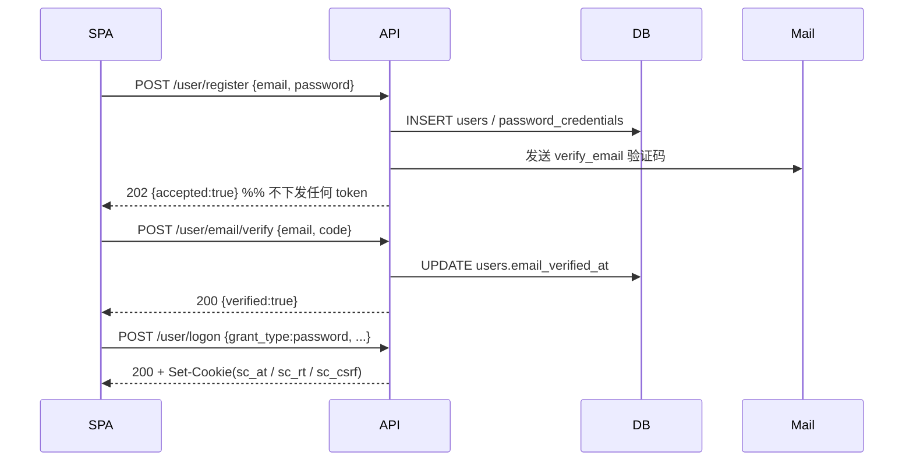
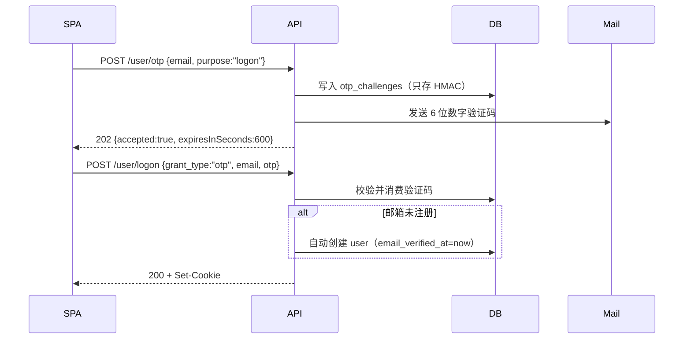
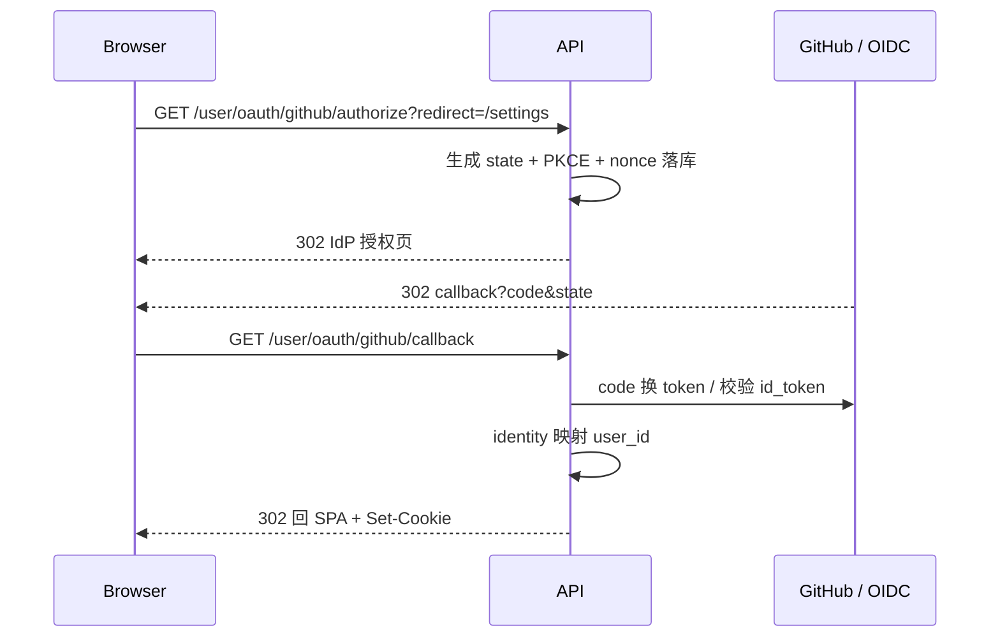

# Summer Camp · 认证服务

Express + TypeScript 的登录/注册服务，支持三种身份来源，最终都收敛为「本系统 user_id + JWT（HttpOnly Cookie）」：

| 身份来源 | 状态 | 说明 |
| --- | --- | --- |
| 邮箱 + 密码 | ✅ 已实现 | 注册后需验证邮箱 |
| 邮箱 + 一次性验证码（OTP） | ✅ 已实现 | 首次登录自动开户 |
| 第三方（GitHub OAuth2 / 通用 OIDC） | ✅ 提供扩展点 | 微信可作为下一个实现接入 |

---

## 1. 技术栈

- Express 4 + TypeScript（`strict`）
- MySQL 8 + `mysql2/promise`（全部走预处理语句）
- `zod` 请求校验 / `pino` 结构化日志 / `helmet` + `cors`
- `jsonwebtoken`（HS256，可按需换 RS256 + JWKS）
- `bcryptjs`（纯 JS，免编译）+ `nodemailer`
- `jose`（校验 OIDC 的 id_token）

---

## 2. 快速开始

```bash
cd server
cp .env.example .env      # 按需修改 MySQL / 密钥
npm install
npm run migrate           # 自动建库建表
npm run dev               # http://localhost:3000
npm run smoke             # 另开终端，跑端到端冒烟测试
```

没有本地 MySQL？用 Docker 起一个：

```bash
docker run -d --name summer-camp-mysql \
  -e MYSQL_ROOT_PASSWORD=devpass \
  -e MYSQL_DATABASE=summer_camp \
  -p 3306:3306 mysql:8.4
# .env 里把 MYSQL_PASSWORD 改成 devpass
```

> 未配置 `SMTP_HOST` 时，验证码会以 `[DEV MAIL]` 的形式打印在服务端日志里，方便本地调试。

### 预置账号（Admin / Supervisor）

线上用镜像部署时不需要人工注册再改库——启动时会按环境变量幂等创建：

| 变量 | 说明 |
| --- | --- |
| `BOOTSTRAP_ON_START` | `true` 时在 `listen` 之前执行 seed；多副本部署请设为 `false`，改用 Job |
| `BOOTSTRAP_ADMIN_EMAIL` / `BOOTSTRAP_ADMIN_PASSWORD` | 唯一管理员 |
| `BOOTSTRAP_SUPERVISOR_1_EMAIL` / `_PASSWORD` | 督导 1 |
| `BOOTSTRAP_SUPERVISOR_2_EMAIL` / `_PASSWORD` | 督导 2 |
| `*_PASSWORD_FILE` | 可选，指向 Docker secret / k8s Secret 文件，优先于明文变量 |
| `BOOTSTRAP_ENFORCE_ROLE` | 已有账号角色不一致时是否强制纠正，默认只告警 |

行为约定：

- 账号不存在 → 创建（`role` 正确、`email_verified_at` 已填，可直接密码登录）
- 账号已存在 → **永不覆盖密码**，仅补齐缺失的邮箱验证 / 密码凭证
- 账号存在但角色不符 → 默认只 WARN，避免 env 泄露变成提权通道
- 邮箱重复 / EMAIL 与 PASSWORD 不成对 / 密码不足 16 位 → 启动直接失败

手动执行（幂等，可重复）：

```bash
npm run migrate
npm run seed:accounts           # 开发（tsx 直跑源码）
node dist/bootstrap/seed-cli.js # 生产镜像（无 devDependencies）
```

Docker 镜像里两种接法（任选其一）：

```bash
# A. 启动时自动 seed
BOOTSTRAP_ON_START=true node dist/index.js

# B. 多副本：seed 只跑一次，再关掉开关
node dist/bootstrap/seed-cli.js && BOOTSTRAP_ON_START=false node dist/index.js
```

---

## 3. 目录结构

```
server/src
├── index.ts                  # 进程入口：启动 + 优雅关闭
├── app.ts                    # express 装配（helmet / cors / cookie / 错误处理）
├── routes.ts                 # 根路由：/healthz、/user
├── config/                   # 环境变量 zod 校验，配置错误启动即失败
├── bootstrap/                # 预置 admin / supervisor 账号（幂等 seed）
├── db/
│   ├── pool.ts               # 连接池（UTC、utf8mb4、事务封装）
│   ├── migrate.ts            # 极简迁移器
│   └── migrations/001_init.sql
├── common/                   # errors / logger / crypto / validate / http
├── middleware/               # authenticate / csrf / trusted-origin / error-handler
├── infra/
│   ├── rate-limit.store.ts   # 限流抽象（现在是 MySQL 实现，可换 Redis）
│   └── audit.log.ts          # auth_audit 审计
└── user/                     # ★ 所有登录逻辑都在这里
    ├── user.routes.ts / user.controller.ts / user.service.ts
    ├── user.repository.ts / identity.repository.ts / user.schema.ts / user.types.ts
    ├── auth/
    │   ├── password.service.ts      # bcrypt + 时序防护
    │   ├── otp.service.ts           # 验证码签发/校验（HMAC 落库）
    │   ├── token.service.ts         # JWT 签发/校验
    │   ├── session.service.ts       # refresh token 旋转 + 复用检测
    │   ├── denylist.repository.ts   # jti 黑名单
    │   ├── cookies.ts               # HttpOnly Cookie 读写
    │   └── mail.service.ts
    └── oauth/
        ├── identity-provider.ts     # 统一接口
        ├── oauth.service.ts         # 授权码交换 + 账号映射
        ├── oauth.routes.ts
        └── providers/{github,oidc}.ts
```

---

## 4. 认证流程

### 4.1 注册 → 验证邮箱 → 密码登录



**为什么注册不直接发 token**：避免有人用别人的邮箱抢注并立刻拿到会话；只有证明邮箱归属（验证码）之后才允许登录。

### 4.2 邮箱 OTP 登录（首次自动开户）



### 4.3 刷新与登出

- `POST /user/token/refresh` 读取 `sc_rt` → **旋转**出新 refresh token，旧的立即失效
- 旧 token 再次出现 = 被窃取 → 整个 family 全部吊销（复用检测）
- `POST /user/logout` → 吊销 family + 把当前 access token 的 `jti` 写入黑名单

### 4.4 第三方登录（当前为扩展点）



账号映射规则（按优先级）：

1. `(provider, provider_user_id)` 已绑定 → 直接登录
2. 本次带 `link_user_id`（已登录用户主动绑定）→ 建立绑定
3. 否则新建账号；**若邮箱已存在则返回 `oauth_error=link_required`，绝不自动合并**

---

## 5. 接口清单

所有接口前缀 `/user`，请求/响应均为 JSON。错误统一返回 `application/problem+json`。

| 方法 | 路径 | 说明 | 认证 |
| --- | --- | --- | --- |
| POST | `/user/register` | 注册（发验证码） | — |
| POST | `/user/otp` | 发送一次性验证码 | — |
| POST | `/user/email/verify` | 校验注册验证码 | — |
| POST | `/user/logon` | 登录（密码 / 验证码） | — |
| POST | `/user/token/refresh` | 刷新 access token | Cookie + CSRF |
| GET | `/user/csrf` | 取回 CSRF token | — |
| POST | `/user/logout` | 登出 | Cookie + CSRF |
| GET | `/user/me` | 当前用户 + 已绑定身份 | Cookie |
| POST | `/user/password/change` | 设置 / 修改密码 | Cookie + CSRF |
| GET | `/user/oauth/providers` | 可用的第三方登录 | — |
| GET | `/user/oauth/:provider/authorize` | 发起授权（`?link=1` 表示绑定） | 可选 |
| GET | `/user/oauth/:provider/callback` | 第三方回调 | — |

### 5.1 注册

```http
POST /user/register
Content-Type: application/json

{ "email": "a@b.com", "password": "Passw0rd!2024", "displayName": "Clover" }
```

```http
HTTP/1.1 202 Accepted
{ "accepted": true }
```

> 无论邮箱是否已注册都返回 202：新邮箱建号并发验证码；已注册则给邮箱所有者发提示邮件，**不会覆盖原密码**。

### 5.2 发送验证码

```http
POST /user/otp

{ "email": "a@b.com", "purpose": "logon" }   // logon | verify_email
```

```http
HTTP/1.1 202 Accepted
{ "accepted": true, "expiresInSeconds": 600 }
```

### 5.3 登录

```http
POST /user/logon

{ "grant_type": "password", "email": "a@b.com", "password": "Passw0rd!2024" }
// 或
{ "grant_type": "otp", "email": "a@b.com", "otp": "246810" }
```

```http
HTTP/1.1 200 OK
Set-Cookie: sc_at=...; HttpOnly; Path=/; SameSite=Lax
Set-Cookie: sc_rt=...; HttpOnly; Path=/user/token; SameSite=Strict
Set-Cookie: sc_csrf=...; Path=/; SameSite=Strict

{
  "tokenType": "Bearer",
  "expiresIn": 900,
  "user": { "id": "01J...", "email": "a@b.com", "emailVerified": true, "status": "active", "displayName": null, "createdAt": "2026-11-08T..." },
  "csrfToken": "..."
}
```

**token 只放在 HttpOnly Cookie 里，响应体不返回**，前端 JS 拿不到，显著降低 XSS 窃取风险。
`csrfToken` 同时出现在响应体和可读 Cookie 中，方便前后端跨子域部署时取用。

### 5.4 刷新 / 登出

```http
POST /user/token/refresh
Cookie: sc_rt=...; sc_csrf=...
X-CSRF-Token: <与 sc_csrf 相同>
```

```http
POST /user/logout
Cookie: sc_at=...; sc_csrf=...
X-CSRF-Token: <与 sc_csrf 相同>
→ 204 No Content
```

### 5.5 其他

```http
GET /user/me
→ { "user": {...}, "identities": [{ "provider": "github", "email": "a@b.com", "createdAt": "..." }] }

POST /user/password/change
{ "currentPassword": "旧密码", "newPassword": "新密码" }
→ { "revokedSessions": 2 }
```

---

## 6. 错误码

响应体形如：

```json
{
  "type": "about:blank#invalid_grant",
  "title": "invalid_grant",
  "status": 401,
  "code": "invalid_grant",
  "detail": "邮箱或密码不正确"
}
```

| code | HTTP | 含义 |
| --- | --- | --- |
| `validation_failed` | 400 | 参数校验失败（`errors` 里有字段级明细） |
| `invalid_grant` | 401 | 凭证无效（密码错 / 验证码错 / 会话失效，不区分具体原因） |
| `unauthorized` | 401 | 未登录或 JWT 已失效或被拉黑 |
| `email_unverified` | 403 | 邮箱未验证 |
| `csrf_token_invalid` | 403 | CSRF 双提交校验失败 |
| `origin_not_allowed` | 403 | 请求来源不在白名单 |
| `forbidden` | 403 | 账号被禁用等 |
| `rate_limited` | 429 | 触发限流，响应头带 `Retry-After` |
| `internal_error` | 500 | 服务端异常（细节只写日志） |

---

## 7. 安全设计要点

| 项 | 做法 |
| --- | --- |
| 密码 | bcrypt cost 12；bcryptjs 纯 JS 免编译，换 argon2id 只需改 `password.service.ts` |
| 时序攻击 | 账号不存在时也执行一次 dummy compare |
| 验证码 | HMAC-SHA256 落库、6 位、10 分钟、单次消费、错误 5 次作废、60 秒重发冷却 |
| 账号枚举 | 注册/发码统一 202；登录失败统一 `invalid_grant` |
| 限流 | `rate_limit_events` 滑动窗口，按 email + IP 双维度；登录成功清零 |
| JWT | HS256、`iss/aud/exp/nbf` 全校验、`jti`、`sid`、`amr`、15 分钟有效期 |
| 登出 | refresh family 吊销 + access token `jti` 黑名单 |
| Refresh 旋转 | 一次性、原子 `UPDATE ... WHERE revoked_at IS NULL`、复用即吊销全家族 |
| Cookie | `HttpOnly` + `SameSite` + 生产环境自动 `Secure`（本地 HTTP 开发不加） |
| CSRF | Origin 白名单 + 双提交 Token（`X-CSRF-Token`） |
| 第三方登录 | Authorization Code + PKCE + state + nonce；id_token 交给 `jose` 校验；**不按邮箱自动合并** |
| 审计 | `auth_audit` 记录注册/登录/发码/绑定/改密，写入失败不影响主流程 |
| 日志 | pino redact 掉 cookie、authorization、password、otp、token |

---

## 8. 多实例扩展预留

单实例部署即可运行，但下面几处已经是**接口 + 实现**分离，扩展到多实例时只需替换实现：

| 能力 | 当前实现 | 多实例方案 |
| --- | --- | --- |
| 限流计数 | `infra/rate-limit.store.ts` → MySQL | `rateLimitStore.replace(new RedisRateLimitStore())` |
| jti 黑名单 | `TokenRevocationStore` → MySQL | 换 Redis，`isRevoked` 走缓存 |
| 会话 | `refresh_tokens` 表（天然共享） | 无需改 |
| 部署 | 无状态进程 + MySQL | 直接水平扩容，记得 `app.set('trust proxy', 1)` |
| JWT 验签 | HS256 单密钥 | 换 RS256 + JWKS，多服务可独立验签 |

---

## 9. 后续可以做的事

- [ ] 忘记密码流程（`reset_password` 用途已在表结构里预留）
- [ ] 微信登录（`openid/unionid` 没有邮箱，需要先让用户在站内绑定邮箱）
- [ ] 新设备/新 IP 登录邮件提醒
- [ ] `refresh_tokens` / `jwt_denylist` / `rate_limit_events` 的定时清理任务
- [ ] 触发式人机验证（连续失败后要求）
- [ ] OpenAPI 文档（当前接口契约见本文档）
